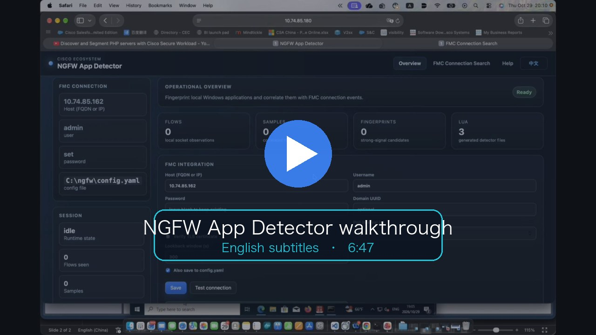
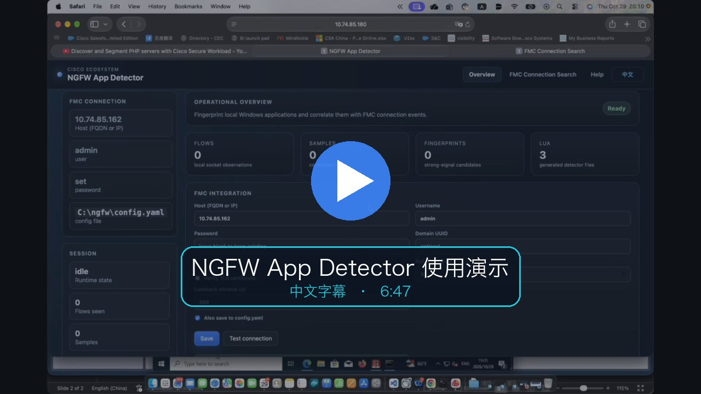

# NGFW App Detector 1.2.0

**English** | [简体中文](README.zh-CN.md)

> Windows portable application for creating Cisco Secure Firewall custom Lua application detectors.

## Video tutorial

A walkthrough of NGFW App Detector using China Merchants Securities as the example: install and open the web UI on Windows → configure the FMC connection → pick the target process and start capture → launch the app and correlate with FMC connection events → review signals and exclude CDNs → generate the Lua → import it into FMC and verify the app is identified. Length 6 min 47 s.

| English subtitles | 中文字幕 |
|---|---|
| [](https://cdn.jsdelivr.net/gh/ongwei76/Cisco-NGFW-APPDetector@main/NGFW_appdetector/docs/videos/NGFW_App_Detector_Tutorial_EN.mp4) | [](https://cdn.jsdelivr.net/gh/ongwei76/Cisco-NGFW-APPDetector@main/NGFW_appdetector/docs/videos/NGFW_App_Detector_Tutorial_ZH.mp4) |
| [Play online (720p)](https://cdn.jsdelivr.net/gh/ongwei76/Cisco-NGFW-APPDetector@main/NGFW_appdetector/docs/videos/NGFW_App_Detector_Tutorial_EN.mp4) · [Download 1080p](https://github.com/ongwei76/Cisco-NGFW-APPDetector/releases/download/app-detector-v1.2.0/NGFW_App_Detector_Tutorial_EN_1080p.mp4) · [Subtitles SRT](docs/videos/NGFW_App_Detector_Tutorial_EN.srt) | [在线播放（720p）](https://cdn.jsdelivr.net/gh/ongwei76/Cisco-NGFW-APPDetector@main/NGFW_appdetector/docs/videos/NGFW_App_Detector_Tutorial_ZH.mp4) · [下载 1080p](https://github.com/ongwei76/Cisco-NGFW-APPDetector/releases/download/app-detector-v1.2.0/NGFW_App_Detector_Tutorial_ZH_1080p.mp4) · [字幕 SRT](docs/videos/NGFW_App_Detector_Tutorial_ZH.srt) |

## 1. Product purpose

Cisco Secure Firewall's built-in application library cannot cover every internal, industry-specific, or custom desktop application. NGFW App Detector identifies network connections created by a selected Windows process, correlates those connections with Cisco Secure Firewall Management Center (FMC) Connection Events, and generates a reviewable custom Lua Application Detector from FMC-parsed signals.

The workflow is:

1. Select a Windows process such as `TdxW.exe`.
2. Read the Windows socket table and record local TCP five-tuples owned by that process.
3. Query FMC Connection Events.
4. Correlate Local Flows with FMC events by source/destination address, ports, protocol, and time.
5. Extract strong signals such as HTTP Host, TLS SNI, certificate names, and stable domain suffixes.
6. Let the operator exclude CDN, shared cloud, or other high-false-positive domains.
7. Generate a Lua Application Detector.
8. Deploy it through FMC and verify new events by custom Web App name.

The product provides auditable and adjustable application identification when a required application is absent from Cisco's built-in detector library.

## 2. Important technical boundaries

- The product does not capture local packet payloads.
- It does not install Npcap, WinPcap, Wireshark, WinDivert, or a custom kernel driver.
- The endpoint component reads Windows socket/process information to attribute a five-tuple to a process.
- Host, SNI, certificate, URL, and similar application-layer fields come from FTD/FMC Connection Events.
- The primary validated scenario is Windows TCP application traffic.
- UDP/QUIC attribution is partial because many Windows UDP sockets have no fixed remote endpoint.
- Very short connections may open and close between socket-table polling intervals.

## 3. Supported environment

Recommended initial targets:

- Windows 10 22H2 x64
- Windows 11 22H2/23H2/24H2 x64
- A modern Chromium/Edge/Firefox browser
- Cisco Secure Firewall Management Center and managed FTD
- Target Windows traffic routed through the FTD
- Connection Event logging enabled on the relevant Access Control rules

Not currently committed as fully supported:

- Windows 7/8/8.1
- 32-bit Windows
- Windows ARM64
- Windows Server Core
- Windows S Mode
- Every UDP/QUIC application
- Highly restricted AppLocker/WDAC environments

Standard-user execution often works for desktop applications owned by the current user. Run as administrator on a controlled test endpoint when complete PID, process-name, and connection visibility is required.

## 4. Bundle contents

```text
Start-NgfwAppDetector.bat       starts the product and opens the browser
Stop-NgfwAppDetector.bat        stops the product
README.md                       complete English guide (this file)
README.zh-CN.md                 complete Chinese guide
README-Windows.txt              bilingual quick start
VERSION.txt                     product version
config.example.yaml             example configuration without real credentials
ngfw-appdetector\
  ngfw-appdetector.exe          main executable
  _internal\                    embedded Python and runtime dependencies
logs\                           runtime log directory
```

Files that may be created at runtime:

```text
config.yaml
generated_detectors\*.lua
generated_detectors\cdn_history.json
logs\ngfw-appdetector-web.log
```

## 5. Installation

This release is a portable bundle. It does not use MSI and does not register itself in Windows Installed Apps.

1. Download `ngfw-appdetector-windows-portable-1.2.0.zip` and its `.sha256.txt` from GitHub Releases: <https://github.com/ongwei76/Cisco-NGFW-APPDetector/releases/tag/app-detector-v1.2.0>, and copy them to a trusted Windows endpoint.
2. Compare its SHA256 with the publisher-provided `.sha256.txt`:

   ```powershell
   Get-FileHash .\ngfw-appdetector-windows-portable-1.2.0.zip -Algorithm SHA256
   ```

3. Extract the entire ZIP. Do not run the EXE from the archive preview.
4. Use a user-writable location such as:

   ```text
   C:\Tools\NGFW-App-Detector\
   ```

5. Double-click `Start-NgfwAppDetector.bat`.
6. The browser opens `http://127.0.0.1:8765`.
7. If SmartScreen warns about an unsigned build, verify its source and SHA256 before following organizational policy.

You do not need to install Python, pip, Npcap, Wireshark, WinPcap, WinDivert, or a browser extension.

## 6. Included components

| Component | Purpose | Machine impact |
|---|---|---|
| Python 3.12 runtime | Executes the application | Stored only in the product directory |
| psutil | Enumerates sockets, PIDs, and processes | User-mode Windows API calls; no driver |
| FastAPI / Starlette | Web API | Used only by this process |
| Uvicorn / httptools | Local HTTP server | Binds to `127.0.0.1:8765` by default |
| Requests / urllib3 / certifi | FMC HTTPS access | Connects to the configured FMC |
| Pydantic / PyYAML | Configuration validation | No system-level modification |
| Jinja2 | Lua rendering | No system-level modification |
| Typer / Rich / Click | CLI and logging | No system-level modification |
| HTMX | Partial page refresh | Bundled static asset; no Internet CDN required |
| PyInstaller runtime | Embedded Python startup | No service or driver installation |
| Microsoft VC runtime DLLs | Python runtime support | Carried in the product directory |

These components are not installed as separate Windows applications.

## 7. Machine changes and impact

### On extraction

- Creates files only under the selected directory.
- Does not install a kernel driver or virtual adapter.
- Does not install a Windows Service.
- Does not create a Scheduled Task.
- Does not enable WinRM.
- Does not add an inbound firewall rule.
- Does not modify system PATH.
- Does not install system Python.
- Does not modify browser settings.

### While running

- Starts the user-mode `ngfw-appdetector.exe` process.
- Opens a loopback-only HTTP listener on `127.0.0.1:8765`.
- Periodically reads system socket/process tables, causing modest CPU usage on high-connection systems.
- Logs in to the configured FMC and queries Connection Events.
- Writes logs, optional configuration, Lua files, and CDN history under the extracted directory.
- Only when the Shared Lua Library page is opened: anonymously queries the latest commit using the read-only Git HTTPS protocol on `github.com`, then reads the index and Lua at that commit from `raw.githubusercontent.com` or `cdn.jsdelivr.net`. No Git installation or anonymous GitHub REST API quota is needed. Submitting a Lua saves the package under `generated_detectors\submissions\` and remembers the nickname and email in `sharing_settings.json`. The program only reads the library and never writes to GitHub.
- Only when **Import selected to FMC** is clicked: logs in to the FMC Web UI with the configured account and creates applications and detectors under Custom Application Detectors in the Inactive state. It never activates or deploys.

### Credential impact

An FMC password entered without persistence remains only in process memory. If “Also save to config.yaml” is selected, the FMC username and password are written to local YAML. This is not an encrypted secret store.

- Restrict directory permissions.
- Use a least-privilege FMC account.
- Never include a real `config.yaml` in a distribution ZIP, email, ticket, or repository.
- Remove credentials from shared endpoints after use.

Users need no GitHub account or credentials. The program contains no maintainer or publishing function and never stores a GitHub token.

### Network and policy impact

The local product does not block business traffic. However, an activated Detector changes application classification on FMC/FTD. Access Control, QoS, SSL, IPS, and reporting behavior can change if those policies reference the custom application. Review shared CDN and broad suffix signals before production deployment.

## 8. Uninstallation

1. Run `Stop-NgfwAppDetector.bat`.
2. Confirm that `ngfw-appdetector.exe` is no longer running.
3. Back up `generated_detectors`, `config.yaml`, or logs if required.
4. Delete the extracted directory.

No additional uninstaller is required because the portable build does not install a service, driver, Scheduled Task, or system Python.

## 9. Prerequisites

### Network

- The Windows endpoint can reach FMC over HTTPS.
- Target traffic traverses the intended FTD.
- Windows, FTD, and FMC clocks are reasonably synchronized.
- FMC/FTD policy deployment is healthy.

### FMC

- Use a dedicated event-query account.
- Enable Connection Event logging on the relevant Access Control rule.
- Use Log at Beginning and/or Log at End as appropriate.
- Confirm FMC already receives events from the Windows endpoint.
- Prepare a backup, change window, and rollback plan before importing a production Detector.

### Target application

- Start from a clean application instance.
- Know the target process name.
- Prepare representative business operations.
- Minimize unrelated applications during capture.

## 10. Detailed usage

### 10.1 Start

Run `Start-NgfwAppDetector.bat`. The browser opens:

```text
http://127.0.0.1:8765
```

The main page displays the release version, for example `v1.2.0`.

For an alternate port:

```bat
ngfw-appdetector\ngfw-appdetector.exe serve --no-browser --host 127.0.0.1 --port 9000
```

### 10.2 Configure FMC

Enter:

- FMC host or IP;
- username and password;
- optional Domain UUID;
- TLS verification setting;
- polling interval, normally 10 seconds;
- lookback window, normally 60 seconds.

Click **Test connection**. Persisting settings writes them to `config.yaml`; review the credential warning above.

### 10.3 Select the target process

1. Start the target desktop application.
2. Select its process from **Target process**.
3. Click **Refresh processes** if needed.
4. If it remains unavailable, run the product as administrator and confirm the application is running.

Use **Exclude hosts** for domains already known not to belong to the target application.

### 10.4 Capture

1. Click **Start**.
2. Exercise representative target-application features.
3. Cover multiple operations and sessions instead of only startup/update traffic.
4. Expand Local Flow rows to inspect correlated FMC EVENT records.

### 10.5 Stop and FMC drain

1. Click **Stop**.
2. Local collection stops immediately.
3. FMC polling continues for approximately 30 seconds to collect delayed events.
4. Generate Lua remains disabled during the countdown.
5. When the state becomes stopped, results freeze and generation is enabled.

FTD inspection, event logging, transfer, FMC ingestion, and polling all contribute to event delay.

### 10.6 Review correlation

For each Local Flow:

- expand its FMC EVENT section;
- compare timestamps and five-tuples;
- review Action, Web App, Rule, Policy, and Host/SNI;
- confirm the event belongs to the target application;
- note unrelated/shared domains for exclusion.

### 10.7 Name and generate

Click **Generate Lua** and enter the FMC application name:

- 1–15 English letters or underscores;
- no digits, spaces, hyphens, or Chinese characters.

Examples: `CMS_App`, `TdxW`, `Finance_Client`.

### 10.8 Review CDN signals

The dialog shows TLS SNI, certificate names, TLS suffixes, and HTTP Hosts that will be written to Lua.

Mark shared CDN, third-party cloud, public login, update, telemetry, advertising, or analytics domains as CDN exclusions.

- A first-party SNI may remain useful even when its backend uses a CDN.
- Shared provider names such as `*.cloudfront.net`, `*.azureedge.net`, `*.akamaiedge.net`, or `*.msedge.net` are high risk.
- Broad corporate suffixes may match other products.
- Excluding an exact CDN host also removes an overlapping suffix that could re-include it.

Selections are stored in `generated_detectors\cdn_history.json`. When a historical CDN reappears unselected, choose:

- **Exclude and generate**;
- **Keep and generate**;
- **Review again**.

Generation is rejected if all usable strong signals are excluded.

### 10.9 View and download Lua

Download the result link or select a file from the left-side Lua history list. Generated files are stored under `generated_detectors`.

### 10.10 Import into FMC

Menu labels vary by release, but the typical workflow is:

1. Open Policies / Application Detectors.
2. Choose Create Detector.
3. Create an Advanced/Custom Lua Detector.
4. Use the same English application name.
5. Paste or upload the generated Lua.
6. Resolve FMC validation errors.
7. Set the Detector to Active.
8. Deploy to the FTD that inspects target traffic.
9. Wait for successful deployment.

### 10.11 Validate

1. Fully close and reopen the target application.
2. Generate new traffic.
3. Wait for FMC ingestion.
4. Open **FMC Connection Search**.
5. Enter the generated name in **Web App**.
6. Search a suitable lookback window.
7. Confirm new events show the custom application.
8. Sample unrelated applications to detect false positives.

Existing long-lived connections may retain old classification.

### 10.12 Shared Lua Library (download and submit Lua)

Open **Shared Lua Library** in the top navigation, or select a file in the Lua history and click **Submit selected Lua to the library**.

**How it works:** the library is reviewed and published by one maintainer (`yongwli@cisco.com`). It is stored in the `library/` folder of the public GitHub repository <https://github.com/ongwei76/Cisco-NGFW-APPDetector>. **Users need no GitHub account and no token.**

```text
User: create package ──email──▶ Maintainer: review offline in a private tool and publish ──▶ public GitHub repo
                                                                                                             │
All users: Shared Lua Library page reads library/index.json anonymously ◀────────────────────────────────────┘
```

**Downloading a published Lua:**

1. Find the application in **Published detectors**. You can filter by app, submitter, Host/SNI, or notes.
2. Click **View**, check the Host/SNI patterns, and confirm the **SHA256 verified** badge. Download is refused when the SHA256 does not match.
3. Click **Download**, import the Lua into FMC (10.10), then validate it (10.11).
4. For questions, click **Ask** to email the maintainer. The subject includes the detector name and version.

**One-click import into FMC:**

1. Save the FMC address, username, and password in **Configure FMC**. Use the same account as for capture; it must be allowed to manage Application Detectors.
2. Tick the detectors to import. **Select all** ticks only the latest version of each application.
3. Click **Import selected to FMC** and confirm. For each detector the program:
   - reads the Lua from the library and verifies its SHA256 again;
   - **skips** it, without overwriting, when an application with the same name already exists in FMC;
   - creates the application with the library's FMC category, risk, and business relevance. If the category does not exist on that FMC version, `others` is used and the result says so;
   - uploads the Lua and saves the detector as **Inactive**. If any step fails, the new detector and application are deleted automatically.
4. The page shows a per-detector result (imported / skipped / failed) and a summary.
5. Review the detectors in FMC **Policies > Application Detectors**, activate them manually, deploy to FTD, and validate them (10.11).

Clicking **Refresh** resolves the latest branch commit using GitHub's standard read-only Git HTTPS protocol, then reads the index and Lua at that immutable commit. This avoids stale Raw branch caches hiding a newly published version. **No GitHub account, token, or Git installation is required**, and anonymous REST API rate limits do not apply. Ordinary reads use a 60-second in-memory cache; looking up an uncached version automatically refreshes the index once.

The page shows **latest GitHub commit** or **jsDelivr at the latest GitHub commit** when the index and downloads come from the same commit. Only if the latest commit cannot be queried does it fall back to Raw/mirror branch caches, explicitly warning that recent changes may be delayed. Such a fallback cannot guarantee visibility of newly published, edited, or removed entries.

**Submitting your Lua:**

1. Validate the Lua on FMC first.
2. Under **Submit a Lua to the maintainer**, select the local Lua, choose the **FMC application category** (required; it matches the FMC built-in categories and is used when importing into FMC), risk, and business relevance, and enter:
   - a **nickname**, which is published;
   - your **email**, which only the maintainer sees and uses to reply;
   - the FMC version you tested with;
   - notes, such as the validation result and excluded CDN domains.
3. Click **Create package and email maintainer**. The program:
   - creates `NGFW-Lua-Submission-<App>-<time>.zip`, containing the Lua and a `submission.json` with its SHA256;
   - downloads the ZIP through the browser and also saves a copy in `generated_detectors\submissions\`;
   - opens your default email client with the recipient, subject, and body filled in.
4. **Attach the ZIP manually** and send the email, because email links cannot add attachments. If no email client opens (for example, the built-in Windows Mail app has no account), click **Copy email text** and send it from your mailbox.
5. The maintainer replies by email. Once approved, the detector appears in the list for everyone.

**Privacy:** the repository is public, so the Lua, nickname, and notes are visible to everyone. The submitter's email appears only in the email to the maintainer and is never written to the repository.

**Review and publishing:** the maintainer does this offline with a separate private tool that is not distributed with this program.

The library location, maintainer email, and mirror setting are in the `sharing` section of `config.yaml` (see `config.example.yaml`).

## 11. Troubleshooting

### UI does not open

- Confirm the EXE is running.
- Read `logs\ngfw-appdetector-web.log`.
- Check whether port 8765 is occupied.
- Extract the ZIP fully before running.

### Target process is missing

- Start the application first.
- Refresh the process list.
- Try administrator execution.
- Check EDR, AppLocker, or WDAC restrictions.

### Few Local Flows

- Restart the target application to create new connections.
- Exercise more features.
- Very short sockets may be missed by polling.

### Local Flow exists but FMC Event does not

- Confirm traffic traverses the FTD.
- Enable Connection Event logging.
- Check system clocks.
- Wait for the 30-second drain.
- Expand the FMC Search lookback.

### Lua generation is unavailable

- Stop capture and wait for drain completion.
- Collect at least the configured number of strong-signal samples; default is 3.
- Keep at least one strong non-CDN signal.
- Use a valid application name.

### FMC TLS errors

- Enable verification with a trusted FMC certificate.
- Disable it only for controlled self-signed lab environments.
- Prefer a trusted certificate in production.

## 12. Security guidance

- Run only on a trusted endpoint.
- Keep the default loopback listener; do not bind directly to `0.0.0.0`.
- Use a least-privilege FMC account.
- Protect `config.yaml`.
- Do not distribute real credentials, logs, or sensitive detector results.
- Review every host and suffix before production import.
- Validate first with a test policy/device.
- Sign production ZIPs and EXEs with organizational Authenticode.
- Publish and verify SHA256 over a trusted channel.

## 13. Build

Build on Windows x64:

```bat
scripts\Build-Windows-AllInOne.bat 1.2.0
```

Outputs:

```text
release\ngfw-appdetector-windows-portable-1.2.0.zip
release\ngfw-appdetector-windows-portable-1.2.0.zip.sha256.txt
```

## 14. AI-driven batch verification workflow

The full workflow for using an AI assistant to run apps in bulk, generate Lua, verify on FMC/FTD and publish is in [ai_workflow/AI_WORKFLOW.md](ai_workflow/AI_WORKFLOW.md) (Chinese: [AI_WORKFLOW.zh-CN.md](ai_workflow/AI_WORKFLOW.zh-CN.md)).
