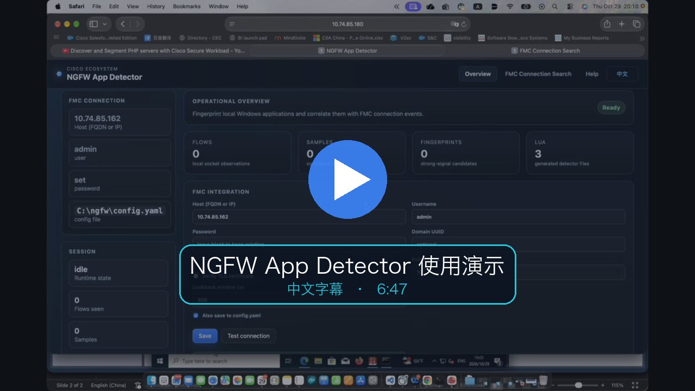
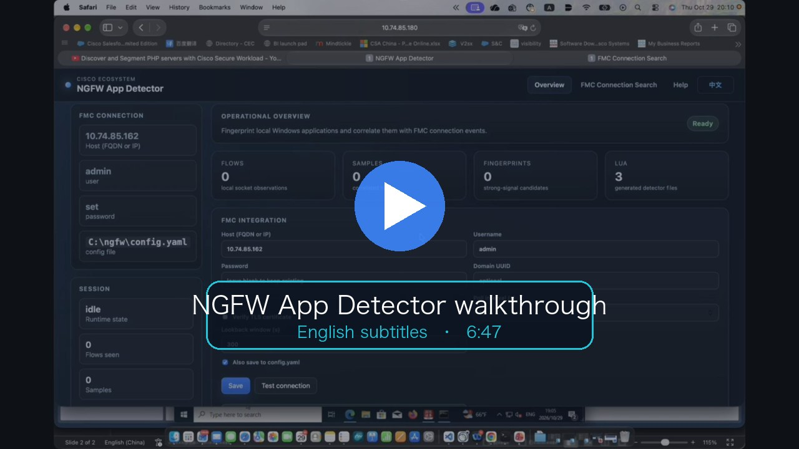

# NGFW App Detector 1.2.0

[English](README.md) | **简体中文**

> 用于生成 Cisco Secure Firewall 自定义 Lua Application Detector 的 Windows 便携工具。

## 视频教程

完整演示 NGFW App Detector 的使用过程（以招商证券为例）：在 Windows 上安装并打开 Web 界面 → 配置 FMC 连接 → 选择目标进程开始采集 → 启动应用产生流量，与 FMC 连接事件关联 → 审核特征、排除 CDN → 生成 Lua → 导入 FMC 并验证应用识别生效。时长 6 分 47 秒。

| 中文字幕 | English subtitles |
|---|---|
| [](https://cdn.jsdelivr.net/gh/ongwei76/Cisco-NGFW-APPDetector@main/NGFW_appdetector/docs/videos/NGFW_App_Detector_Tutorial_ZH.mp4) | [](https://cdn.jsdelivr.net/gh/ongwei76/Cisco-NGFW-APPDetector@main/NGFW_appdetector/docs/videos/NGFW_App_Detector_Tutorial_EN.mp4) |
| [在线播放（720p）](https://cdn.jsdelivr.net/gh/ongwei76/Cisco-NGFW-APPDetector@main/NGFW_appdetector/docs/videos/NGFW_App_Detector_Tutorial_ZH.mp4) · [下载 1080p](https://github.com/ongwei76/Cisco-NGFW-APPDetector/releases/download/app-detector-v1.2.0/NGFW_App_Detector_Tutorial_ZH_1080p.mp4) · [字幕 SRT](docs/videos/NGFW_App_Detector_Tutorial_ZH.srt) | [Play online (720p)](https://cdn.jsdelivr.net/gh/ongwei76/Cisco-NGFW-APPDetector@main/NGFW_appdetector/docs/videos/NGFW_App_Detector_Tutorial_EN.mp4) · [Download 1080p](https://github.com/ongwei76/Cisco-NGFW-APPDetector/releases/download/app-detector-v1.2.0/NGFW_App_Detector_Tutorial_EN_1080p.mp4) · [Subtitles SRT](docs/videos/NGFW_App_Detector_Tutorial_EN.srt) |

## 1. 产品目的

Cisco Secure Firewall 的内置应用识别库无法覆盖所有企业内部软件、行业客户端和定制应用。NGFW App Detector 用于识别某个 Windows 本地进程实际建立的网络连接，将这些连接与 Cisco Secure Firewall Management Center（FMC）的 Connection Events 关联，并利用 FMC 已解析出的强特征生成自定义 Lua Application Detector。

完整流程如下：

1. 在 Windows 上选择目标进程，例如 `TdxW.exe`。
2. 读取 Windows Socket 表，记录该进程建立的本地 TCP 连接五元组。
3. 查询 FMC Connection Events。
4. 按源/目的 IP、端口、协议和时间窗口关联 Local Flow 与 FMC Event。
5. 提取 HTTP Host、TLS SNI、证书名称和稳定域名后缀等强信号。
6. 由用户检查并排除 CDN、共享云服务或其他容易误报的域名。
7. 生成可在 FMC 中创建/激活的 Lua Application Detector。
8. 部署到 FTD 后，通过 FMC Connection Search 验证新连接是否命中自定义 Web App 名称。

本产品的目标是减少依赖厂商内置应用库，为客户提供可审核、可调整、可验证的本地应用识别能力。

## 2. 重要技术边界

- 产品不抓取本地数据包内容。
- 产品不安装 Npcap、WinPcap、Wireshark、WinDivert 或自定义内核驱动。
- 本地端主要读取 Windows Socket/Process 信息，用于确认五元组属于哪个进程。
- Host、SNI、证书、URL 等应用层字段来自 FTD/FMC Connection Events。
- 当前经过真实验证的主要场景是 Windows TCP 应用流量。
- UDP Socket 在 Windows 上经常没有固定远端地址，因此 UDP/QUIC 的进程归属属于部分支持，不能保证覆盖所有 UDP 场景。
- 极短连接如果在两次 Socket 轮询之间完成，可能无法被本地采集捕获。

## 3. 支持环境

首批建议环境：

- Windows 10 22H2 x64
- Windows 11 22H2/23H2/24H2 x64
- 现代 Chromium/Edge/Firefox 浏览器
- Cisco Secure Firewall Management Center 与受管 FTD
- Windows 主机流量必须经过待验证的 FTD
- FMC Access Control 规则必须记录 Connection Events

尚未承诺正式支持：

- Windows 7/8/8.1
- 32 位 Windows
- Windows ARM64
- Windows Server Core
- Windows S Mode
- 所有 UDP/QUIC 应用
- 禁止未知程序运行的 AppLocker/WDAC 极端加固环境

普通用户通常可以采集当前用户启动的桌面应用。为了获得更完整的 PID、进程名称和连接信息，建议在受控测试终端上以管理员权限运行。

## 4. 分发包内容

解压后的主要文件：

```text
Start-NgfwAppDetector.bat       启动程序并打开浏览器
Stop-NgfwAppDetector.bat        停止程序
README.md                       英文完整说明
README.zh-CN.md                 中文完整说明（本文）
README-Windows.txt              中英文快速开始
VERSION.txt                     产品版本
config.example.yaml             配置示例，不包含真实密码
ngfw-appdetector\
  ngfw-appdetector.exe          主程序
  _internal\                    内嵌 Python 与运行时依赖
logs\                           运行日志目录
```

程序运行后还可能创建：

```text
config.yaml                     用户选择持久化时保存 FMC 配置
generated_detectors\*.lua       生成的 Lua Detector
generated_detectors\cdn_history.json
                                用户历史 CDN 排除选择
logs\ngfw-appdetector-web.log   Web 服务日志
```

## 5. 安装方法

本版本是便携分发包，不使用 MSI，也不向 Windows“已安装的应用”注册产品。

1. 从 GitHub Releases 下载 `ngfw-appdetector-windows-portable-1.2.0.zip` 及其 `.sha256.txt`：<https://github.com/ongwei76/Cisco-NGFW-APPDetector/releases/tag/app-detector-v1.2.0>，复制到可信 Windows 主机。
2. 如发布方同时提供 `.sha256.txt`，先计算 ZIP 的 SHA256 并进行比对：

   ```powershell
   Get-FileHash .\ngfw-appdetector-windows-portable-1.2.0.zip -Algorithm SHA256
   ```

3. 右键 ZIP，选择“全部解压”。不要直接从 ZIP 预览窗口运行 EXE。
4. 建议解压到当前用户可写目录，例如：

   ```text
   C:\Tools\NGFW-App-Detector\
   ```

5. 双击：

   ```text
   Start-NgfwAppDetector.bat
   ```

6. 程序默认只监听本机回环地址：

   ```text
   http://127.0.0.1:8765
   ```

7. 如果 Windows Defender SmartScreen 对未签名程序提示警告，请先核对来源和 SHA256，再由组织安全策略决定是否允许运行。

无需单独安装 Python、pip、Npcap、Wireshark、WinPcap、WinDivert 或浏览器插件。

## 6. 安装和运行包含的组件

分发包内嵌以下用户态组件：

| 组件 | 用途 | 对系统的影响 |
|---|---|---|
| Python 3.12 runtime | 执行主程序 | 仅位于产品目录，不注册系统 Python |
| psutil | 枚举 Socket、PID 和进程 | 用户态调用 Windows API，不安装驱动 |
| FastAPI / Starlette | Web API | 仅由本产品进程使用 |
| Uvicorn / httptools | 本地 HTTP 服务 | 默认只监听 `127.0.0.1:8765` |
| Requests / urllib3 / certifi | 访问 FMC HTTPS | 向用户配置的 FMC 发起连接 |
| Pydantic / PyYAML | 配置读取和校验 | 无系统级修改 |
| Jinja2 | 渲染 Lua 文件 | 无系统级修改 |
| Typer / Rich / Click | 命令行和日志 | 无系统级修改 |
| HTMX | Web 页面局部刷新 | 随程序静态资源提供，不需要外网 CDN |
| PyInstaller runtime | 打包和启动内嵌 Python | 不安装系统服务或驱动 |
| Microsoft VC runtime DLL | Python 执行依赖 | 随产品目录携带，不写入系统目录 |

这些组件不会作为独立 Windows 软件安装。

## 7. 对安装机器的修改和影响

### 7.1 解压时

- 在用户选择的位置创建产品文件。
- 不创建内核驱动。
- 不创建虚拟网卡。
- 不安装 Windows Service。
- 不创建 Scheduled Task。
- 不启用 WinRM。
- 不新增 Windows 防火墙入站规则。
- 不修改系统 PATH。
- 不安装系统级 Python。
- 不修改浏览器配置。

### 7.2 运行时

- 启动 `ngfw-appdetector.exe` 用户态进程。
- 在 `127.0.0.1:8765` 打开本地 HTTP 监听。
- 定期读取系统 Socket 和进程表；在连接数量非常大的主机上会产生少量 CPU 使用。
- 连接用户配置的 FMC，登录 FMC Web UI 并查询 Connection Events。
- 浏览器只访问本机 UI；产品 Web 静态资源已打包在本地。
- 在本地目录写入日志、配置、Lua 和 CDN 历史。
- 仅在打开 “Lua 共享库” 时：通过 `github.com` 的只读 Git HTTPS 协议匿名查询最新提交，再从 `raw.githubusercontent.com` 或 `cdn.jsdelivr.net` 读取同一提交的索引和 Lua；无需安装 Git，也不消耗 GitHub 匿名 REST API 配额。提交 Lua 时在 `generated_detectors\submissions\` 保存提交包，并在 `sharing_settings.json` 记住昵称和邮箱。程序只读取共享库，不会向 GitHub 写入任何内容。
- 仅在点击 “导入所选到 FMC” 时：使用已配置的 FMC 账号登录 FMC Web UI，在 Custom Application Detectors 中创建应用和 Detector（状态为 Inactive）；不会激活、不会部署。

### 7.3 凭据影响

如果只在 UI 中填写 FMC 密码但不选择持久化，密码只保存在当前程序内存中。

如果选择“同时保存到 config.yaml”，FMC 用户名和密码将写入本地 YAML 文件。当前配置文件不是加密凭据库。必须：

- 将产品目录权限限制为授权用户；
- 使用最低权限 FMC 账号；
- 不要把真实 `config.yaml` 放入分发 ZIP、邮件、工单或代码仓库；
- 在共享终端上使用后及时清理。

使用者不需要任何 GitHub 账号或凭据。本程序不包含维护/发布功能，也不保存任何 GitHub Token。

### 7.4 网络和策略影响

- 本程序本身不阻断业务流量。
- 生成并激活的 Detector 会改变 FMC/FTD 对流量的应用分类。
- 如果 Access Control、QoS、SSL、IPS 或报表引用该自定义应用，错误 Detector 可能改变策略结果。
- 共享 CDN 或过宽域名会造成误报，生产启用前必须审核并验证。

## 8. 卸载方法

1. 双击 `Stop-NgfwAppDetector.bat`。
2. 确认任务管理器中没有 `ngfw-appdetector.exe`。
3. 如需保留成果，先备份：

   ```text
   generated_detectors\
   config.yaml
   logs\
   ```

4. 删除整个解压目录。

因为便携版不安装 Service、驱动、计划任务或系统级 Python，所以不需要额外卸载程序。

## 9. 使用前准备

### 9.1 网络准备

- Windows 测试主机能够访问 FMC HTTPS。
- Windows 目标应用流量经过相应 FTD。
- 本地和 FMC 时间应尽可能同步。
- FMC/FTD 已完成健康部署。

### 9.2 FMC 准备

- 创建用于查询事件的专用 FMC 账号。
- 确认相关 Access Control Rule 已启用 Connection Event 日志。
- 建议在规则中使用 Log at Beginning 和/或 Log at End，以满足实际验证需求。
- 确认 FMC 中能够看到该 Windows 主机产生的事件。
- 在生产环境导入 Detector 前，准备配置备份、变更窗口和回退方案。

### 9.3 应用准备

- 关闭目标应用的旧实例。
- 启动目标应用并确认目标进程名称。
- 准备能够产生代表性流量的业务操作。
- 避免同时运行大量不相关应用，以减少共享域名干扰。

## 10. 详细使用方法

### 10.1 启动产品

双击 `Start-NgfwAppDetector.bat`。命令窗口会保持运行，浏览器打开：

```text
http://127.0.0.1:8765
```

主页面顶部显示产品版本，例如：

```text
v1.2.0
```

如端口被占用，请先停止占用 `8765` 的程序，或在命令行使用其他端口：

```bat
ngfw-appdetector\ngfw-appdetector.exe serve --no-browser --host 127.0.0.1 --port 9000
```

### 10.2 配置 FMC

在“FMC 集成配置”中填写：

- FMC 地址：FQDN 或 IP；
- 用户名；
- 密码；
- Domain UUID：通常可以留空；
- Verify TLS：只有证书链可信时启用；
- Poll interval：建议 10 秒；
- Lookback window：建议 60 秒。

点击“测试连接”确认登录和事件读取成功。

“同时保存到 config.yaml”会把 FMC 配置写入本地文件。请参考前面的凭据风险说明。

### 10.3 选择目标进程

1. 先启动目标桌面应用。
2. 在“目标进程”下拉框选择进程，例如 `TdxW.exe`。
3. 如果没有看到目标进程，点击右侧“刷新进程”。
4. 如果仍不可见，尝试以管理员权限启动产品并确认应用确实在运行。

“排除的 Host”可预先填写明确不应属于目标应用的域名，多个域名用逗号分隔。

### 10.4 开始采集

1. 点击“开始采集”。
2. 产品开始读取目标进程的 Local Flow，同时轮询 FMC。
3. 在目标应用中执行登录、查询、行情、下载、业务提交等具有代表性的操作。
4. 建议覆盖多个功能和多个会话，避免只采集启动页或更新检查。
5. 展开 Local Flow，可以查看关联的 FMC EVENT。

### 10.5 停止和等待 FMC

1. 点击“停止采集”。
2. 本地 Socket 采集立即停止。
3. FMC 查询继续约 30 秒，以接收延迟入库的 Connection Events。
4. 倒计时结束前“生成 Lua”按钮保持禁用。
5. 状态变为“已停止”后，最终结果冻结，可以生成 Detector。

FMC 事件延迟来自 FTD 检测、事件记录、传输、FMC 入库和轮询，不代表本地采集失败。

### 10.6 检查关联结果

对每条 Local Flow：

1. 点击左侧箭头；
2. 查看其下方的 FMC EVENT；
3. 检查时间、五元组、Action、Web App、Rule、Policy 和 Host/SNI；
4. 确认事件确实属于目标应用；
5. 发现明显无关域名时，在下一步将其作为 CDN/共享服务排除。

### 10.7 生成 Lua 和设置应用名称

点击“生成 Lua”后：

1. 输入最终在 FMC 中显示的应用名称；
2. 名称只允许 1–15 个英文字母或下划线；
3. 不允许中文、数字、空格或连字符；
4. 示例：

   ```text
   CMS_App
   TdxW
   Finance_Client
   ```

### 10.8 检查 Host、SNI 和 CDN

生成弹窗列出准备写入 Lua 的：

- TLS SNI；
- TLS 证书名称；
- TLS Host Suffix；
- HTTP Host。

对于共享 CDN、第三方云平台、公共登录、更新、遥测、广告或统计域名，勾选“作为 CDN 排除”。

风险原则：

- 企业自有 SNI 即使后端使用 CDN，也可能是可靠特征；
- `*.cloudfront.net`、`*.azureedge.net`、`*.akamaiedge.net`、`*.msedge.net` 等共享厂商域名通常风险较高；
- 过宽的根域后缀可能匹配同一企业的其他产品；
- 选择精确 CDN 域名时，生成器也会移除可能重新命中它的重叠后缀。

CDN 选择会写入：

```text
generated_detectors\cdn_history.json
```

如果历史曾将某域名标记为 CDN，而本次未勾选，系统会要求明确选择：

- 排除并生成；
- 保留并生成；
- 返回检查。

如果所有可用强特征都被排除，系统拒绝生成空 Detector。

### 10.9 下载和查看 Lua

生成成功后：

- 点击结果中的 Lua 文件名下载；
- 或在左侧“历史生成的 Lua”下拉框选择文件；
- 页面下方显示完整 Lua 内容；
- 可以使用“下载所选 Lua”保存。

生成目录默认是：

```text
generated_detectors\
```

### 10.10 在 FMC 导入 Detector

不同 FMC 版本菜单文字可能略有不同，一般流程：

1. 登录 FMC；
2. 打开 Policies / Application Detectors；
3. 选择 Create Detector；
4. 创建 Advanced/Custom Lua Detector；
5. 填写与生成时一致的英文应用名称和说明；
6. 粘贴或上传生成的 Lua；
7. 保存并处理 FMC 显示的语法或配置错误；
8. 将 Detector 设置为 Active；
9. 将配置部署到负责目标流量的 FTD；
10. 等待部署成功。

Detector 本身用于分类。只有策略引用该应用时，才可能影响允许、阻断、QoS、解密或其他动作。

### 10.11 验证 Detector

1. 完全关闭目标应用；
2. 重新启动目标应用，建立新连接；
3. 等待 FTD/FMC 事件入库；
4. 打开产品的 “FMC 连接事件查询” 页面；
5. 在 “Web 应用” 输入生成的应用名称；
6. 设置合适回溯时间并查询；
7. 确认新 Connection Event 的 Web App 显示自定义应用；
8. 同时抽查无关应用，确认没有误报。

长连接可能保留旧分类，因此验证前必须创建新连接。

### 10.12 Lua 共享库（下载和提交 Lua）

打开顶部导航 “Lua 共享库”，或在左侧 Lua 历史中选择文件后点击 “提交所选 Lua 到共享库”。

**工作方式：**共享库由维护者（`yongwli@cisco.com`）统一审核发布，存放在公开 GitHub 仓库 <https://github.com/ongwei76/Cisco-NGFW-APPDetector> 的 `library/` 目录。**使用者不需要 GitHub 账号，也不需要任何 Token。**

```text
使用者：生成提交包 ──邮件──▶ 维护者：用专用维护工具离线审核并发布 ──▶ GitHub 公开仓库
                                                                                   │
所有使用者：“Lua 共享库”页面匿名读取 library/index.json ◀──────────────────────────┘
```

**下载已发布的 Lua：**

1. 在 “已发布的 Detector” 列表中找到应用（可按应用名、提交者、Host/SNI、备注筛选）；
2. 点击 “查看”，检查 Host/SNI 规则，并确认显示 “SHA256 校验通过”。校验不一致时程序会拒绝下载；
3. 点击 “下载”，按照 10.10 导入 FMC，再按 10.11 验证；
4. 有疑问时点击 “咨询”，给维护者发邮件（标题自动带上 Detector 名称和版本）。

**一键导入到 FMC：**

1. 先在 “配置 FMC” 中保存 FMC 地址、用户名和密码（与采集使用同一账号，需要能管理 Application Detectors）；
2. 在列表中勾选要导入的 Detector；“全选”只勾选每个应用的最新版本；
3. 点击 “导入所选到 FMC” 并确认。程序对每个 Detector：
   - 从共享库读取 Lua 并再次校验 SHA256；
   - FMC 中已存在同名应用时**跳过**，不覆盖；
   - 按共享库中的 “FMC 应用分类”、风险等级、业务相关性创建应用；该 FMC 版本没有这个分类时使用 `others` 并在结果中提示；
   - 上传 Lua 并保存 Detector，**状态为 Inactive**；任一步失败会自动删除刚创建的 Detector 和应用；
4. 页面显示每个 Detector 的结果（已导入 / 已跳过 / 失败）和汇总；
5. 在 FMC **Policies > Application Detectors** 中确认后手动激活，并部署到 FTD，再按 10.11 验证。

点击“刷新”时，程序通过 GitHub 标准只读 Git HTTPS 协议查询分支最新提交，再按这个固定提交号读取索引和 Lua，避免 Raw 分支缓存导致刚发布的新版暂时不可见。**不需要 GitHub 账号、Token 或安装 Git**，也不依赖匿名 REST API 的访问配额。普通读取最多使用 60 秒内存缓存；请求尚未缓存的新版本时会自动刷新一次索引。

页面显示“GitHub 最新提交”或“jsDelivr 镜像中的 GitHub 最新提交”时，索引和下载内容来自同一提交。若无法查询最新提交，才回退到 Raw/镜像的分支缓存，并明确提示“最新变化可能有延迟”；此时不能保证已看到刚发布、编辑或下架的内容。

**提交自己的 Lua：**

1. 先在 FMC 上验证 Lua 能命中；
2. 在 “提交 Lua 给维护者” 中选择本地 Lua，选择 **FMC 应用分类**（必选，与 FMC 内置分类一致，导入 FMC 时使用）、风险等级和业务相关性，填写**昵称**（会公开）、**邮箱**（仅维护者可见，用于回复）、测试的 FMC 版本和备注（建议写明验证结果和排除的 CDN 域名）；
3. 点击 “生成提交包并发邮件给维护者”。程序会：
   - 生成 `NGFW-Lua-Submission-<应用名>-<时间>.zip`（包含 Lua 和带 SHA256 的 `submission.json`），下载到浏览器下载目录，并另存一份到 `generated_detectors\submissions\`；
   - 打开默认邮件程序，收件人、标题和正文已填好；
4. **手动把 ZIP 添加为附件**后发送（邮件链接无法自动添加附件）。没有弹出邮件程序时（例如 Windows 自带“邮件”应用没有添加账号），点击 “复制邮件内容”，在你的邮箱里发送；
5. 维护者审核后会回复邮件；通过后，所有使用者都能在列表中看到。

**隐私：**仓库公开，Lua 内容、昵称和备注对所有人可见；提交者邮箱只出现在发给维护者的邮件中，不会写入仓库。

**审核与发布：**由维护者使用单独的私有维护工具离线完成，该工具不随本程序分发。

共享库地址、维护者邮箱和镜像开关可在 `config.yaml` 的 `sharing` 段修改（见 `config.example.yaml`）。

## 11. 故障排查

### 页面无法打开

- 确认 `ngfw-appdetector.exe` 正在运行；
- 查看 `logs\ngfw-appdetector-web.log`；
- 检查 `127.0.0.1:8765` 是否被占用；
- 不要从 ZIP 内直接运行。

### 进程列表没有目标应用

- 先启动目标应用；
- 点击“刷新进程”；
- 尝试管理员权限运行；
- 检查 EDR、AppLocker 或 WDAC 是否限制进程枚举。

### Local Flow 很少

- 目标应用可能复用已有长连接；
- 完全退出后重新打开；
- 执行更多代表性业务操作；
- 极短连接可能在轮询间隔内结束。

### Local Flow 有数据但 FMC Event 没有

- 确认流量经过目标 FTD；
- 确认 Access Control Rule 已启用日志；
- 检查 Windows、FTD 和 FMC 时间；
- 等待停止后的 30 秒排空；
- 在 FMC Connection Search 中扩大回溯窗口。

### 不能生成 Lua

- 必须先停止采集并等待 FMC 排空完成；
- 至少需要配置数量的强信号样本，默认 3 条；
- 不能把全部 Host/SNI 特征都排除；
- 应用名称必须符合格式。

### FMC TLS 错误

- 使用受信任证书时启用 Verify TLS；
- 实验室自签证书环境可以关闭；
- 生产环境建议为 FMC 配置可信证书。

## 12. 安全建议

- 仅在可信终端运行；
- 默认保持 `127.0.0.1` 监听，不要直接绑定 `0.0.0.0`；
- 使用最低权限 FMC 专用账号；
- 保护 `config.yaml`；
- 不要分发真实日志、配置或生成结果中的敏感业务信息；
- 在生产部署 Lua 前检查所有域名和后缀；
- 使用测试 FTD/策略进行首次验证；
- 对分发 ZIP 和 EXE 使用组织代码签名；
- 记录 ZIP SHA256，并通过可信渠道发布。

## 13. 构建说明

必须在 Windows x64 构建：

```bat
scripts\Build-Windows-AllInOne.bat 1.2.0
```

输出：

```text
release\ngfw-appdetector-windows-portable-1.2.0.zip
release\ngfw-appdetector-windows-portable-1.2.0.zip.sha256.txt
```

## 14. AI 驱动的批量验证流程

用 AI 助手批量运行 App、生成 Lua、在 FMC/FTD 上验证并发布的完整流程见 [ai_workflow/AI_WORKFLOW.zh-CN.md](ai_workflow/AI_WORKFLOW.zh-CN.md)（中文）/ [ai_workflow/AI_WORKFLOW.md](ai_workflow/AI_WORKFLOW.md)（English）。
