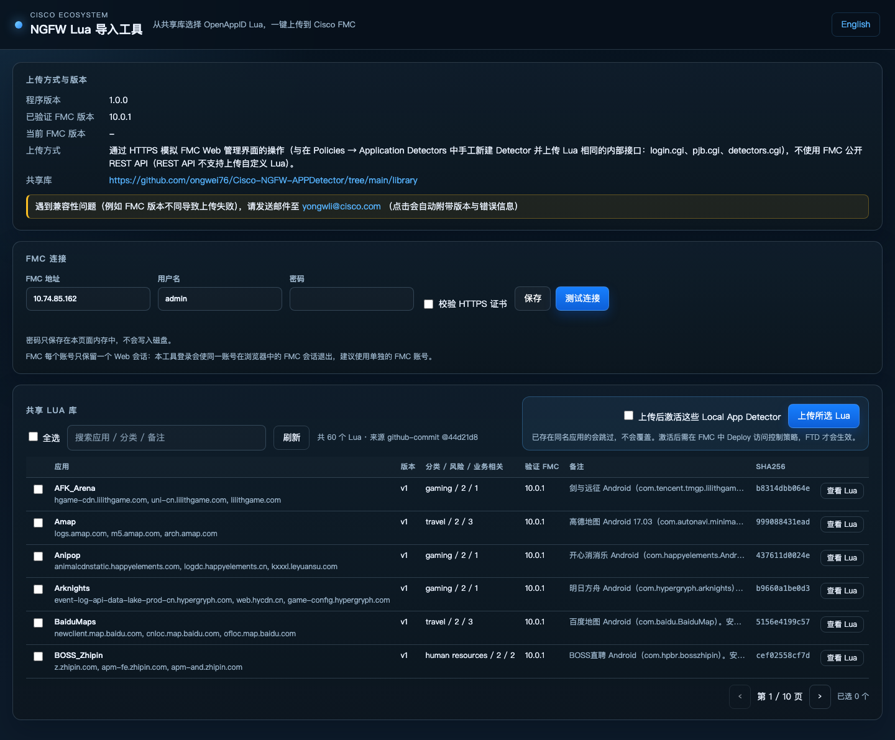
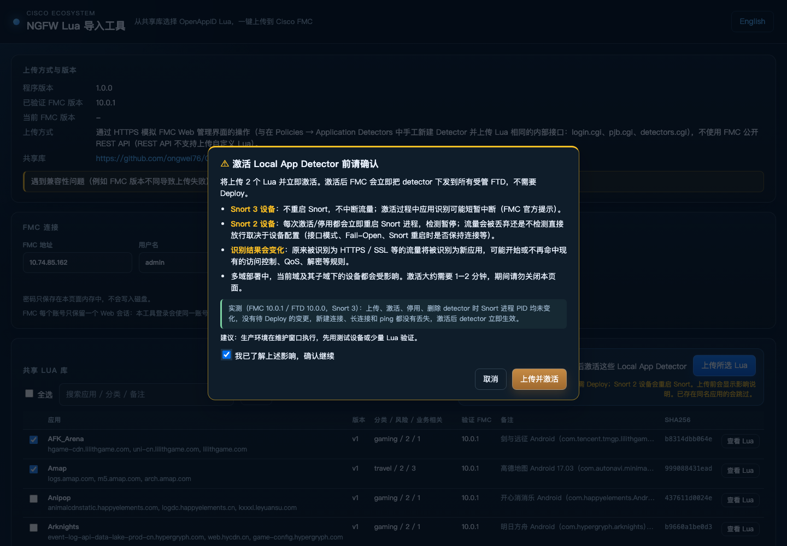
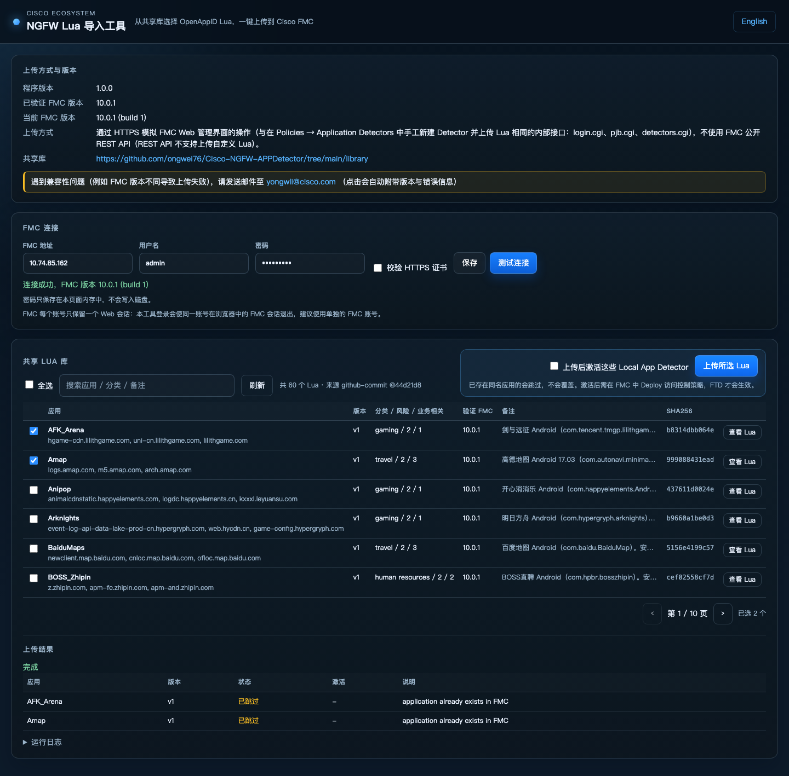

# NGFW Lua Importer（NGFW Lua 导入工具）

一个独立的小程序：**连接 Cisco FMC → 浏览共享 Lua 库 → 勾选需要的 Lua → 一键上传到 FMC 的 Local App Detector，并可选择是否激活。**

使用者不需要自己抓包、分析流量或编写 Lua，直接使用共享库里已经在 FMC/FTD 上验证过的现成 detector 即可。

- 共享库：<https://github.com/ongwei76/Cisco-NGFW-APPDetector/tree/main/library>
- 程序版本：**1.0.1**
- 已验证的 FMC 版本：**10.0.1**（FMC for VMware 10.0.1 Build 1）
- 开发语言：Go（单个可执行文件，无需安装 Python/运行库）
- **遇到兼容性问题请发邮件到 [yongwli@cisco.com](mailto:yongwli@cisco.com)**（详见 [兼容性说明](docs/compatibility.md)）



## 下载与运行

从 GitHub Releases 下载对应平台的文件：<https://github.com/ongwei76/Cisco-NGFW-APPDetector/releases/tag/lua-importer-v1.0.1>

| 平台 | 文件 |
|------|------|
| Windows 10/11 x64 | `ngfw-lua-importer-1.0.1-windows-x64.exe` |
| macOS 11 及以上（Apple 芯片和 Intel 通用） | `ngfw-lua-importer-1.0.1-macos-universal.zip` |
| Linux x64 | `ngfw-lua-importer-1.0.1-linux-x64` |

Release 中的 `SHA256SUMS.txt` 列出了各文件的 SHA256 校验值（自行编译时位于 `dist/SHA256SUMS.txt`）。

**Windows**：双击 `.exe`，会出现一个命令行窗口并自动打开浏览器。

**macOS**：
1. 双击下载的 zip 解压，得到 **NGFW Lua Importer.app**（可拖到“应用程序”文件夹）。
2. 双击打开。程序没有窗口和 Dock 图标，会直接在浏览器中打开操作页面。
3. 首次打开时，macOS 会提示“无法验证开发者”（本程序未经过 Apple 公证）。请点“完成”，然后打开 **系统设置 → 隐私与安全性**，在页面下方点击 **“仍要打开”**，输入登录密码确认。之后再双击就能直接打开。
   也可以在“终端”中执行一次：`xattr -dr com.apple.quarantine "/Applications/NGFW Lua Importer.app"`（路径按实际位置修改）。
4. 再次双击 App 时，如果程序已在运行，会直接打开已有页面，不会重复启动。

**Linux**：`chmod +x ngfw-lua-importer-1.0.1-linux-x64` 后运行。

程序会在本机启动一个只监听 `127.0.0.1:8790` 的网页界面，并自动打开浏览器；如果没有自动打开，请手动访问 <http://127.0.0.1:8790/>。
使用完毕后点击页面右上角的 **“退出程序”**（Windows/Linux 也可以关闭命令行窗口或按 Ctrl+C）。

运行电脑需要能同时访问：
- **FMC 管理地址（HTTPS 443）**：直连，不经过代理；
- **GitHub / jsDelivr**：用于读取共享库。会使用 `HTTPS_PROXY` 环境变量；Windows 上未设置环境变量时，会自动使用 “Internet 选项” 里配置的系统代理。GitHub 访问不了时会自动改用 jsDelivr 镜像。

## 使用步骤

1. **FMC 连接**：填写 FMC 地址（IP、域名或直接粘贴 `https://...` 网址）、用户名、密码，点击“测试连接”。成功后会显示 FMC 版本。
   - “测试连接”左边的“保存”按钮只保存 FMC 地址、用户名和证书校验选项，方便下次打开直接使用（不保存密码）。
   - FMC 通常使用自签名证书，所以默认不校验 HTTPS 证书；如果 FMC 使用受信任证书，可勾选“校验 HTTPS 证书”。
   - 密码只保存在网页内存中，**不会写入磁盘**。程序只记住 FMC 地址、用户名和界面语言（保存在用户配置目录 `NGFW_Lua_Importer/settings.json`）。
2. **选择 Lua**：在“共享 Lua 库”中勾选需要的应用。“全选”后面是搜索框和刷新按钮，每页显示 6 个应用，可翻页；点“查看 Lua”可以先看 Lua 内容。
3. **上传**：上传区域在“共享 Lua 库”卡片的右上角。根据需要勾选“上传后激活这些 Local App Detector”，点击“上传所选 Lua”，确认后在列表下方的“上传结果”中查看每个 Lua 的状态和运行日志。
   - 不勾选激活：确认框说明只上传、不影响业务，之后可在 FMC 手动激活。
   - 勾选激活：确认框会列出对业务的影响（见下文“激活对业务的影响”），必须勾选“我已了解上述影响”才能继续。
4. **Deploy**：激活后 FMC 会立即把 detector 下发到所有受管 FTD，**不需要 Deploy**。只有在访问控制策略中新增或修改了引用这些应用的规则时，才需要按常规 Deploy 策略。





### 激活对业务的影响

| 设备 | 激活 / 停用 / 删除已激活的 detector |
|------|------|
| Snort 3 | 不重启 Snort，不中断流量；激活过程中应用识别可能短暂中断（FMC 弹窗原文：“may temporarily interrupt application detection, but there will be no traffic interruptions”） |
| Snort 2 | 立即在所有受管设备上重启 Snort 进程（无需 Deploy）；流量是被丢弃还是不检测直接放行，取决于接口模式、Fail-Open、Snort 重启时是否保持连接等设置 |

此外，原来被识别为 HTTPS / SSL 等的流量会被识别为新应用，可能开始或不再命中现有的访问控制、QoS、解密规则。多域部署中，当前域及子域的设备都会受影响。生产环境建议在维护窗口操作。

实测（FMC 10.0.1 / FTD 10.0.0，Snort 3，路由模式）：在上传、激活、停用、删除（含删除已激活的）detector 的整个过程中，通过 FMC 的 `show asp inspect-dp snort` 每 1–2 秒查询一次，Snort 进程 PID 始终不变；FMC 没有产生待 Deploy 的变更；FTD 后面的 Windows 测试机每 250 ms 新建 TCP 连接、HTTPS 长连接和 ping 均无丢失；激活后 detector 立即生效（FMC 连接事件中即刻出现新应用名）。每批激活约 100 秒，删除约 3 分钟。

### 上传规则

- 上传前会按共享库 `index.json` 中的 **SHA256 校验** Lua 文件，校验不一致直接拒绝上传。
- FMC 中**已存在同名应用的会跳过，不会覆盖**（Cisco 内置应用和之前导入过的应用都一样）。
- 同一个应用一次只能选一个版本。
- 应用的分类（category）、风险（risk）、业务相关性（business relevance）使用共享库里登记的值；如果该 FMC 上没有这个分类名，会改用 `others` 并在结果里提示。
- 描述统一写为 `NGFW shared Lua library v<版本> (<提交者>)`，方便在 FMC 中识别来源。
- 新建的 detector 默认为 **Inactive**。勾选“激活”后：
  - 本次新上传的 detector 会被激活；
  - 已存在的同名**自定义** detector 如果是 Inactive，也会被激活；Cisco 内置 detector 永远不会被修改。
- 上传失败时会自动删除半成品 detector（FMC 会同时删除随之创建的自定义应用），不会在 FMC 中留下空应用。

## 上传方式说明

FMC 的公开 REST API **不支持**上传自定义 Lua detector，因此本程序通过 HTTPS 复现 FMC 网页界面的操作，与在 **Policies → Application Detectors** 中手工“新建 Detector → 上传 Lua → 保存 → 激活”所用的接口完全相同：

`login.cgi`（登录）→ `/ddd/`（获取会话令牌和 FMC 版本）→ `pjb.cgi` 的 `SF::Cache::RNADetector::*` 函数（建应用、建 detector、保存、激活、列表）→ `RNADetector/detectors.cgi`（上传 Lua 文件）。

完整的请求顺序见 [docs/upload-method.md](docs/upload-method.md)。因为使用的是网页界面的内部接口，不同 FMC 版本之间可能有差异，这正是需要反馈兼容性问题的原因。

> **注意：FMC 每个账号只保留一个网页会话。** 本程序登录后，同一账号在浏览器中打开的 FMC 页面会被退出，反之亦然。建议为本程序单独建立一个 FMC 账号（需要能管理 Application Detectors 的权限，例如 Administrator 或 Network Admin），上传过程中也不要用同一账号登录 FMC。

## 兼容性问题反馈

如果遇到下列情况，请发邮件到 **[yongwli@cisco.com](mailto:yongwli@cisco.com)**：

- 测试连接失败，但用同样的账号可以在浏览器里登录 FMC；
- 上传或激活时提示 `this FMC version may not be compatible`、`unexpected FMC response`、`Lua upload rejected by FMC` 等；
- FMC 版本不是 10.0.1，且结果与预期不同。

界面上的邮件链接会自动带上程序版本、操作系统、FMC 版本和最近一次错误信息，请再附上运行日志（“运行日志”展开即可复制）。详见 [docs/compatibility.md](docs/compatibility.md)。

## 命令行参数

```
ngfw-lua-importer [参数]
  -listen 127.0.0.1:8790   本地网页地址（只允许回环地址）
  -no-browser              不自动打开浏览器
  -version                 显示版本、上传方式和联系邮箱
  -owner ongwei76          共享库 GitHub 账号
  -repo Cisco-NGFW-APPDetector
  -branch main
  -dir library
  -mirror=true             GitHub 不通时使用 jsDelivr 镜像
```

## 安全设计

- 网页只监听本机回环地址；校验 `Host` 头，防止 DNS rebinding。
- 每次启动生成随机令牌，所有 API 请求都必须带上，其他网站无法跨站调用本程序。
- 严格的 Content-Security-Policy，页面不加载任何外部脚本。
- 只读访问 GitHub（匿名），Lua 必须通过 SHA256 校验；Lua 内容只按纯文本显示。
- 不保存 FMC 密码；访问 FMC 不经过代理。

## 从源码构建

需要 Go 1.22 或更新版本：

```bash
./build.sh          # 运行 vet 和测试，在 dist/ 生成 Windows、Linux 可执行文件和 macOS 通用 App（zip，需在 macOS 上编译）
go test ./...       # 只运行测试（包含一个模拟 FMC 的完整上传/激活流程测试）
go run . -no-browser
```

目录结构：

```
NGFW_lua_importer/
├── main.go                 程序入口与命令行参数
├── internal/fmc            FMC 网页接口客户端（登录、上传、激活、回滚）
├── internal/library        共享库读取与 SHA256 校验
├── internal/netproxy       访问 GitHub 时的代理选择（含 Windows 系统代理）
├── internal/server         本地网页服务、上传任务和界面（web/）
├── internal/version        版本、已验证 FMC 版本、联系方式
├── docs/                   上传方式、兼容性说明、截图
├── packaging/macos         macOS App 的 Info.plist 和图标
├── build.sh                交叉编译和打包脚本
└── CHANGELOG.md
```

本程序是 NGFW App Detector 项目的独立子项目，与采集/生成 Lua 的主程序（`NGFW_appdetector`）和库维护工具（`NGFW_lua_maintainer`）互不依赖。

---

## English

**NGFW Lua Importer** is a standalone single-binary tool: connect to Cisco FMC → browse the shared Lua library → select detectors → upload them to FMC Local App Detectors, optionally activating them. Users do not need to capture traffic or write Lua; every library entry has been verified on FMC/FTD.

- Download: <https://github.com/ongwei76/Cisco-NGFW-APPDetector/releases/tag/lua-importer-v1.0.1> — `ngfw-lua-importer-1.0.1-windows-x64.exe`, `ngfw-lua-importer-1.0.1-macos-universal.zip` (one app for Apple silicon and Intel, macOS 11+), `ngfw-lua-importer-1.0.1-linux-x64`; `SHA256SUMS.txt` included.
- Tested FMC version: **10.0.1**. Compatibility problems: email **[yongwli@cisco.com](mailto:yongwli@cisco.com)** (the in-app link pre-fills versions and the last error).
- Run it; it serves a local page on `http://127.0.0.1:8790/` and opens the browser. The UI has a Chinese/English switch and a **Quit** button (top right).
- **macOS:** unzip and open **NGFW Lua Importer.app** (no window or Dock icon; the page opens in the browser, and opening the app again reopens the page). The app is ad-hoc signed but not notarized, so the first launch is blocked: click *Done*, then *System Settings → Privacy & Security → Open Anyway*. Alternatively run `xattr -dr com.apple.quarantine "/Applications/NGFW Lua Importer.app"` once.
- **Linux:** `chmod +x` the binary first.

**Steps:** enter FMC address/username/password → *Test connection* (*Save* stores address, username and TLS option, never the password) → select Lua in the shared library (search, 6 per page, *View Lua*) → optionally tick *Activate these Local App Detectors after upload* → *Upload selected Lua* → check *Upload results*.

**Upload method:** the public FMC REST API cannot upload custom Lua, so the tool automates the FMC Web UI's internal endpoints (`login.cgi`, `pjb.cgi` `SF::Cache::RNADetector::*`, `RNADetector/detectors.cgi`) — the same calls used when you create a detector in *Policies → Application Detectors*. See [docs/upload-method.md](docs/upload-method.md). FMC keeps one Web session per account, so use a dedicated FMC account.

**Rules:** SHA256 of every Lua is verified against the library index; existing applications are skipped, never overwritten; failed uploads are rolled back; Cisco built-in detectors are never modified.

**Activation impact:** activation is pushed to all managed devices immediately — no deploy is needed. On **Snort 3** devices Snort is not restarted and traffic is not interrupted (application detection may be briefly interrupted). On **Snort 2** devices activation/deactivation restarts Snort immediately; whether traffic drops depends on the device configuration. Identification of affected traffic changes (e.g. from HTTPS/SSL to the new app), which may change which access control, QoS or decryption rules match. Measured on FMC 10.0.1 / FTD 10.0.0 (Snort 3): upload, activate, deactivate and delete kept the Snort PIDs unchanged, created no pending deployment and lost no traffic. The upload dialog shows these notes and, when activating, requires an explicit acknowledgement. Use a maintenance window in production.

**Build from source:** Go 1.22+, `./build.sh` on macOS (vet, tests, Windows/Linux binaries and the universal macOS app zip in `dist/`).

