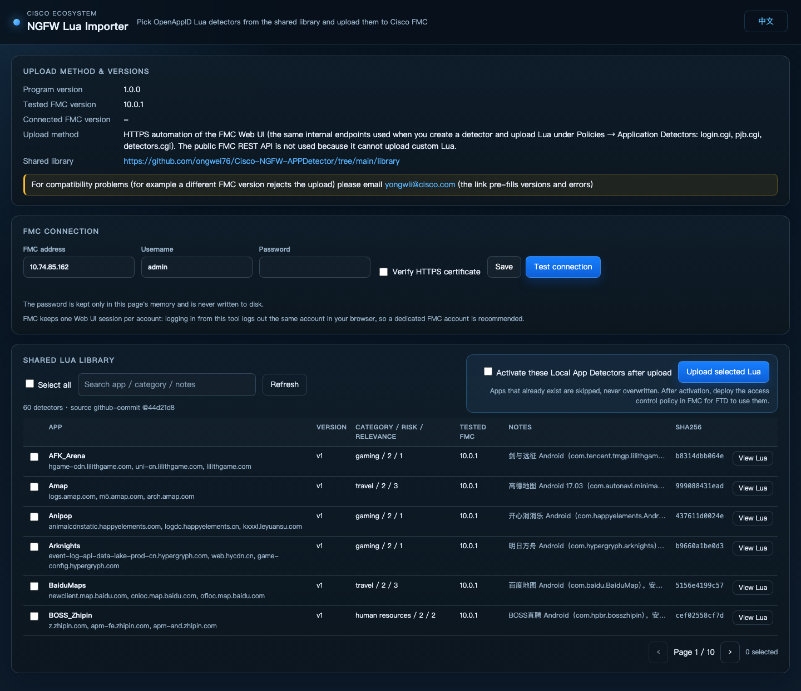
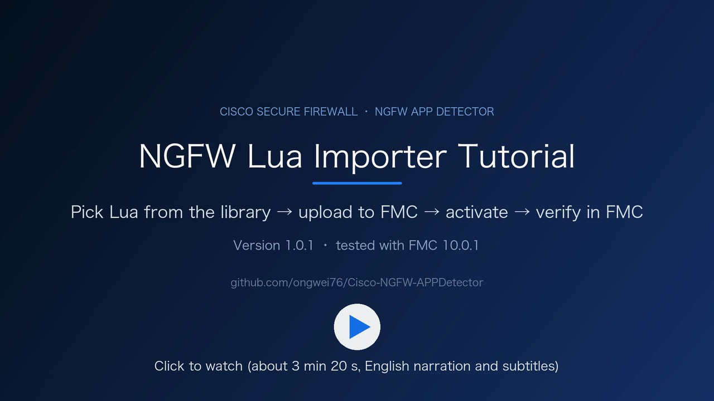
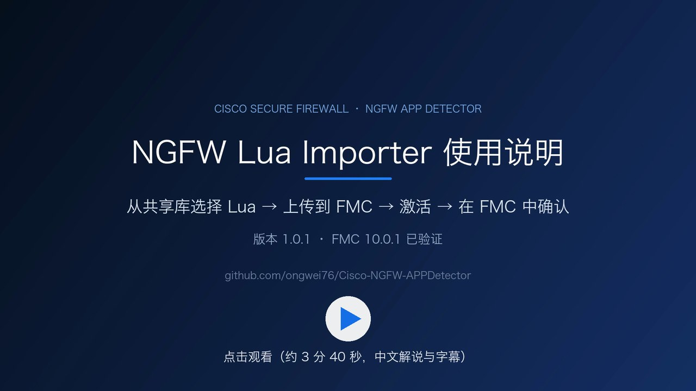

# NGFW Lua Importer

**English** | [简体中文](README.zh-CN.md)

A standalone tool: **connect to Cisco FMC → browse the shared Lua library → select the detectors you need → upload them to FMC Local App Detectors in one click, optionally activating them.**

You do not need to capture traffic, analyze flows or write Lua yourself: every detector in the shared library has already been verified on FMC/FTD.

- Shared library: <https://github.com/ongwei76/Cisco-NGFW-APPDetector/tree/main/library>
- Program version: **1.0.1**
- Tested FMC version: **10.0.1** (FMC for VMware 10.0.1 Build 1)
- Written in Go (a single executable; no Python or runtime to install)
- **For compatibility problems, email [yongwli@cisco.com](mailto:yongwli@cisco.com)** (see [Compatibility](docs/compatibility.md))



The UI has a Chinese/English switch in the top-right corner. Some screenshots below show the Chinese UI.

## Video tutorial

A full walkthrough of importing Lua with this tool: connect to FMC → pick Lua in the shared library → tick activation and acknowledge the impact notice → upload and check the results and run log → log in to FMC and confirm under Policies → Advanced → Applications that the Local App Detector is active. IP addresses in the video are blurred and the upload wait is sped up. Click a cover to play in the browser (GitHub only offers downloads for videos over 10 MB), or download from the [Release page](https://github.com/ongwei76/Cisco-NGFW-APPDetector/releases/tag/lua-importer-v1.0.1).

| English (about 3 min 20 s, English narration + subtitles) | 中文（约 3 分 40 秒，中文解说 + 字幕） |
|---|---|
| [](https://cdn.jsdelivr.net/gh/ongwei76/Cisco-NGFW-APPDetector@main/NGFW_lua_importer/docs/videos/NGFW_Lua_Importer_Tutorial_EN.mp4) | [](https://cdn.jsdelivr.net/gh/ongwei76/Cisco-NGFW-APPDetector@main/NGFW_lua_importer/docs/videos/NGFW_Lua_Importer_Tutorial_ZH.mp4) |
| [Play online](https://cdn.jsdelivr.net/gh/ongwei76/Cisco-NGFW-APPDetector@main/NGFW_lua_importer/docs/videos/NGFW_Lua_Importer_Tutorial_EN.mp4) · [Subtitles SRT](docs/videos/NGFW_Lua_Importer_Tutorial_EN.srt) | [在线播放](https://cdn.jsdelivr.net/gh/ongwei76/Cisco-NGFW-APPDetector@main/NGFW_lua_importer/docs/videos/NGFW_Lua_Importer_Tutorial_ZH.mp4) · [字幕 SRT](docs/videos/NGFW_Lua_Importer_Tutorial_ZH.srt) |

Subtitles are burned into the video; the SRT files are for players or translation.

## Download and run

Download the file for your platform from GitHub Releases: <https://github.com/ongwei76/Cisco-NGFW-APPDetector/releases/tag/lua-importer-v1.0.1>

| Platform | File |
|------|------|
| Windows 10/11 x64 | `ngfw-lua-importer-1.0.1-windows-x64.exe` |
| macOS 11 or later (universal: Apple silicon and Intel) | `ngfw-lua-importer-1.0.1-macos-universal.zip` |
| Linux x64 | `ngfw-lua-importer-1.0.1-linux-x64` |

`SHA256SUMS.txt` in the release lists the SHA256 of each file (when you build it yourself it is in `dist/SHA256SUMS.txt`).

**Windows:** double-click the `.exe`. A console window appears and the browser opens automatically.

**macOS:**
1. Double-click the downloaded zip to get **NGFW Lua Importer.app** (you can drag it into Applications).
2. Double-click it. The app has no window or Dock icon; it opens its page in the browser.
3. On first launch macOS says the developer cannot be verified (the app is not notarized by Apple). Click *Done*, open **System Settings → Privacy & Security**, click **Open Anyway** near the bottom and confirm with your login password. After that it opens directly.
   Alternatively run once in Terminal: `xattr -dr com.apple.quarantine "/Applications/NGFW Lua Importer.app"` (adjust the path).
4. Opening the app again while it is running just reopens the existing page; it does not start a second copy.

**Linux:** run `chmod +x ngfw-lua-importer-1.0.1-linux-x64`, then run it.

The program starts a web UI that listens only on `127.0.0.1:8790` and opens the browser. If the browser does not open, go to <http://127.0.0.1:8790/>.
When you are done, click **Quit** in the top-right corner (on Windows/Linux you can also close the console window or press Ctrl+C).

The computer running it must be able to reach:
- **the FMC management address (HTTPS 443)** directly, not through a proxy;
- **GitHub / jsDelivr** to read the shared library. It uses the `HTTPS_PROXY` environment variable; on Windows, when that is not set, it uses the system proxy from Internet Options. If GitHub is unreachable it falls back to the jsDelivr mirror.

## How to use

1. **FMC connection:** enter the FMC address (IP, host name, or paste an `https://...` URL), username and password, then click *Test connection*. On success the FMC version is shown.
   - The *Save* button next to *Test connection* saves only the FMC address, username and certificate option for next time (never the password).
   - FMC usually has a self-signed certificate, so HTTPS certificates are not verified by default; tick *Verify HTTPS certificate* if your FMC uses a trusted certificate.
   - The password stays only in the page's memory and is **never written to disk**. The program remembers only the FMC address, username and UI language (in `NGFW_Lua_Importer/settings.json` under the user config directory).
2. **Select Lua:** tick the apps you need in *Shared Lua library*. After *Select all* there is a search box and a refresh button; 6 apps per page with paging. *View Lua* shows the Lua content first.
3. **Upload:** the upload area is at the top right of the *Shared Lua library* card. Tick *Activate these Local App Detectors after upload* if needed, click *Upload selected Lua*, confirm, then check each Lua's status and the run log under *Upload results*.
   - Without activation: the confirmation says it only uploads and does not affect traffic; you can activate later in FMC.
   - With activation: the confirmation lists the impact (see "Activation impact" below) and you must tick *I understand the impact above* to continue.
4. **Deploy:** after activation FMC pushes the detectors to all managed FTDs immediately — **no deploy is needed**. Deploy as usual only if you add or change access control rules that reference these apps.


### Activation impact

| Device | Activating / deactivating / deleting an active detector |
|------|------|
| Snort 3 | Snort is not restarted and traffic is not interrupted; application detection may be briefly interrupted while activating (FMC's own notice: "may temporarily interrupt application detection, but there will be no traffic interruptions") |
| Snort 2 | Snort restarts immediately on all managed devices (no deploy needed); whether traffic is dropped or passed uninspected depends on interface mode, Fail-Open, and whether connections are preserved during Snort restarts |

Also, traffic previously identified as HTTPS / SSL etc. is identified as the new app, which may start or stop matching existing access control, QoS or decryption rules. In multi-domain deployments, devices in the current domain and its subdomains are affected. Use a maintenance window in production.

Measured on FMC 10.0.1 / FTD 10.0.0 (Snort 3, routed mode): throughout upload, activation, deactivation and deletion (including deleting active detectors), `show asp inspect-dp snort` polled through FMC every 1–2 s showed unchanged Snort PIDs; FMC created no pending deployment; a Windows test host behind the FTD opening a new TCP connection every 250 ms, a long-lived HTTPS connection and ping lost nothing; detectors took effect right after activation (the new app name appeared in FMC connection events immediately). Each activation batch took about 100 s; deletion about 3 min.

### Upload rules

- Each Lua is **checked against the SHA256** in the shared library's `index.json` before upload; a mismatch is refused.
- Apps that **already exist on FMC are skipped, never overwritten** (both Cisco built-in apps and previously imported ones).
- Only one version of an app can be selected at a time.
- Category, risk and business relevance come from the shared library; if the FMC has no category with that name, `others` is used and noted in the results.
- The description is always `NGFW shared Lua library v<version> (<submitter>)`, so the source is visible in FMC.
- New detectors are **Inactive** by default. With *Activate* ticked:
  - the detectors uploaded in this run are activated;
  - an existing **custom** detector with the same name that is Inactive is also activated; Cisco built-in detectors are never modified.
- If an upload fails, the half-created detector is deleted automatically (FMC deletes the custom app created with it), so no empty apps are left on FMC.

## Upload method

The public FMC REST API **cannot** upload custom Lua detectors, so this tool reproduces the FMC Web UI over HTTPS — exactly the calls used when you create a detector, upload Lua, save and activate under **Policies → Application Detectors**:

`login.cgi` (login) → `/ddd/` (session token and FMC version) → `pjb.cgi` `SF::Cache::RNADetector::*` functions (create app, create detector, save, activate, list) → `RNADetector/detectors.cgi` (upload the Lua file).

The full request sequence is in [docs/upload-method.md](docs/upload-method.md). Because these are internal Web UI endpoints, they may differ between FMC versions — which is why compatibility feedback matters.

> **Note: FMC keeps one Web UI session per account.** When this tool logs in, FMC pages open in a browser with the same account are logged out, and vice versa. Create a dedicated FMC account for this tool (with permission to manage Application Detectors, e.g. Administrator or Network Admin), and do not log in to FMC with the same account during uploads.

## Compatibility feedback

Email **[yongwli@cisco.com](mailto:yongwli@cisco.com)** if:

- *Test connection* fails, but the same account can log in to FMC in a browser;
- upload or activation reports `this FMC version may not be compatible`, `unexpected FMC response`, `Lua upload rejected by FMC`, etc.;
- your FMC version is not 10.0.1 and the result is not what you expect.

The email link in the UI pre-fills the program version, OS, FMC version and the last error; please also attach the run log (expand *Run log* to copy it). See [docs/compatibility.md](docs/compatibility.md).

## Command-line options

```
ngfw-lua-importer [options]
  -listen 127.0.0.1:8790   local web address (loopback only)
  -no-browser              do not open the browser
  -version                 print version, upload method and contact email
  -owner ongwei76          GitHub owner of the shared library
  -repo Cisco-NGFW-APPDetector
  -branch main
  -dir library
  -mirror=true             use the jsDelivr mirror when GitHub is unreachable
```

## Security design

- The web UI listens only on loopback and checks the `Host` header to prevent DNS rebinding.
- A random token is generated at each start and required on every API request, so other websites cannot call the tool cross-site.
- A strict Content-Security-Policy; the page loads no external scripts.
- GitHub is read anonymously and read-only; every Lua must pass the SHA256 check; Lua content is displayed as plain text only.
- The FMC password is never stored; FMC is accessed without a proxy.

## Build from source

Requires Go 1.22 or later:

```bash
./build.sh          # vet and tests, then Windows/Linux binaries and the universal macOS app (zip, must build on macOS) in dist/
go test ./...       # tests only (includes a full upload/activate flow against a mock FMC)
go run . -no-browser
```

Layout:

```
NGFW_lua_importer/
├── main.go                 entry point and command-line options
├── internal/fmc            FMC Web UI client (login, upload, activate, rollback)
├── internal/library        shared library reader and SHA256 check
├── internal/netproxy       proxy selection for GitHub (incl. Windows system proxy)
├── internal/server         local web server, upload jobs and UI (web/)
├── internal/version        version, tested FMC version, contact
├── docs/                   upload method, compatibility, screenshots
├── packaging/macos         Info.plist and icon for the macOS app
├── build.sh                cross-compile and packaging script
└── CHANGELOG.md
```

This tool is a standalone sub-project of NGFW App Detector; it does not depend on the capture/Lua generation app (`NGFW_appdetector`) or the library maintainer tool (`NGFW_lua_maintainer`).
