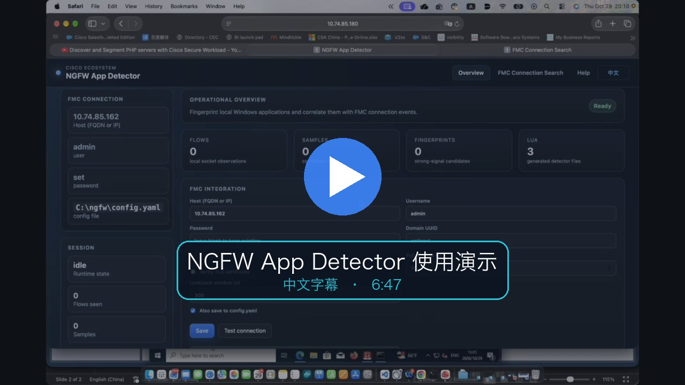
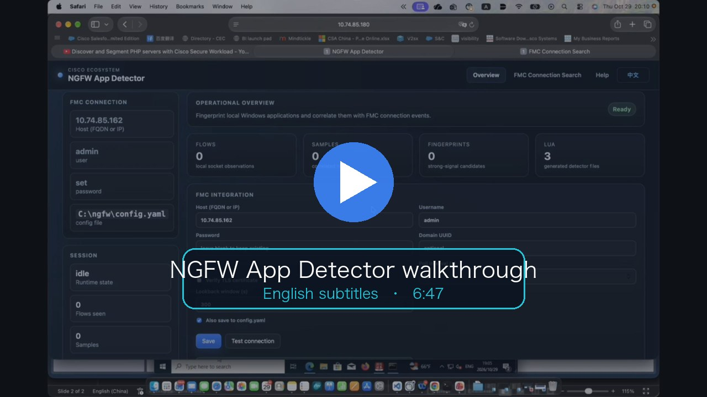
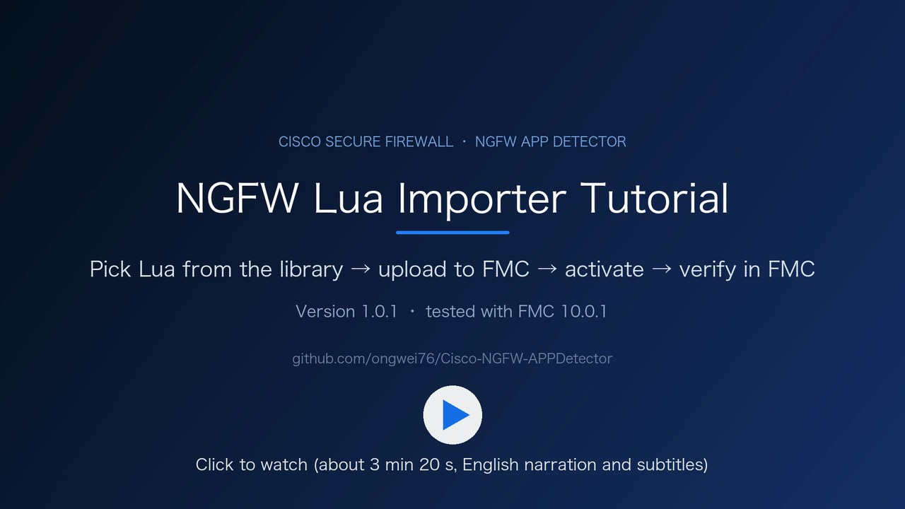

# Cisco NGFW APP Detector

为 Cisco Secure Firewall（FMC / FTD）自动生成、验证并共享 OpenAppID 自定义 Lua 应用检测器（Local App Detector），重点覆盖 FMC 内置应用库尚未识别的国内应用。

Automatically generate, verify and share OpenAppID custom Lua application detectors for Cisco Secure Firewall (FMC / FTD), focusing on Chinese apps that the FMC built-in application library does not yet identify.

## 目录 / Repository layout

| 目录 Directory | 内容 Contents |
|------|------|
| [`library/`](library/) | 共享 Lua 库：每个应用一个目录，`index.json` 为索引（含 SHA256、分类、验证 FMC 版本）。所有条目都在 FMC/FTD 上实际验证过。<br>Shared Lua library, one folder per app; `index.json` lists SHA256, category and tested FMC version. Every entry was verified on FMC/FTD. |
| [`NGFW_appdetector/`](NGFW_appdetector/) | **NGFW App Detector**（Python，Windows）：在终端上运行目标应用，采集并关联流量，自动生成 Lua，导入 FMC 验证，并向共享库提交。<br>Runs the target app on a Windows endpoint, captures and correlates traffic, generates Lua, imports it into FMC for verification and submits it to the library.<br>`ai_workflow/`：AI 驱动的批量验证流程文档和 PPT / AI-driven batch workflow guide and decks. |
| [`NGFW_lua_importer/`](NGFW_lua_importer/) | **NGFW Lua Importer**（Go，Windows/Linux 单文件，macOS 通用 App）：连接 FMC，浏览共享库，勾选后一键上传到 Local App Detector，可选激活。<br>Single-binary tool that connects to FMC, browses the library and uploads selected detectors, optionally activating them. |
| [`presentation/`](presentation/) | 方案介绍 PPT、AI 工作流介绍 PPT、海报（中文 / 英文）。<br>Solution overview decks, AI workflow decks and posters (Chinese / English). |

## 下载 / Downloads

编译好的程序在 [GitHub Releases](https://github.com/ongwei76/Cisco-NGFW-APPDetector/releases)：

| 程序 Program | Release | 文件 Files |
|------|------|------|
| NGFW Lua Importer 1.0.1 | [lua-importer-v1.0.1](https://github.com/ongwei76/Cisco-NGFW-APPDetector/releases/tag/lua-importer-v1.0.1) | Windows x64 `.exe`、macOS 通用 App `.zip`（Apple 芯片 + Intel）、Linux x64、`SHA256SUMS.txt` |
| NGFW App Detector 1.2.0 | [app-detector-v1.2.0](https://github.com/ongwei76/Cisco-NGFW-APPDetector/releases/tag/app-detector-v1.2.0) | Windows 便携包 portable ZIP + `.sha256.txt` |

## 怎么选 / Which tool do I need?

- **只想用现成的 detector**：下载 NGFW Lua Importer，选择共享库中的应用上传到 FMC 即可，无需抓包或写 Lua。详见 [NGFW_lua_importer/README.md](NGFW_lua_importer/README.md)。
- **要为新应用生成 detector**：使用 NGFW App Detector，详见 [NGFW_appdetector/README.md](NGFW_appdetector/README.md)。
- **Just use verified detectors:** download NGFW Lua Importer and upload library entries to FMC — no capture or Lua writing needed. See [NGFW_lua_importer/README.md](NGFW_lua_importer/README.md).
- **Build detectors for new apps:** use NGFW App Detector. See [NGFW_appdetector/README.md](NGFW_appdetector/README.md).
- **让 AI 批量补齐一批 App（例如某市场 Top 50）**：按 [AI 驱动的批量验证](#ai-驱动的批量验证--ai-driven-workflow) 一节的流程，让 AI 助手跑 App、生成 Lua、在 FMC 上验证并发布。
- **Let an AI assistant cover a whole batch of apps (e.g. a market's top 50):** follow the [AI-driven workflow](#ai-驱动的批量验证--ai-driven-workflow) below — the AI runs the apps, generates Lua, verifies on FMC and publishes.

## AI 驱动的批量验证 / AI-driven workflow

**思路**：AI 助手当操作员，NGFW App Detector 当“翻译”，FMC/FTD 当裁判。AI 在测试机/安卓模拟器里批量运行 App 并抓包，只取 App 自有的 SNI/Host 域名（排除 CDN、广告 SDK、母公司共享域名）生成 Lua，导入 FMC 激活后**重新运行 App**，只有在 FMC 连接事件里看到 `Web App = <Lua 名>` 才算通过。人只在清单、范围和发布这几个节点做决定。

**Idea:** the AI assistant is the operator, NGFW App Detector is the translator, FMC/FTD is the referee. The AI runs apps in bulk on a test VM / Android emulator, captures traffic, builds the Lua from app-owned SNI/Host domains only (no CDNs, ad SDKs or parent-company domains), imports and activates it on FMC, then **runs the app again** — it passes only when FMC connection events show `Web App = <Lua name>`. People only decide the app list, the scope and publishing.

```
选清单 Pick list → 查 FMC 内置 Check built-ins → 运行+抓包 Run & capture → 提取自有域名 App-owned domains → 生成 Lua Generate
→ 导入/激活 Import & activate → 二次运行验证 Re-run & verify → 证据 Evidence → 证据 PPT Deck → 发布共享库 Publish
```

已在 7 轮实测中跑通（券商 PC 客户端、视频 App、中国安卓 Top 20/50/100、安卓手游 Top 30、香港市场 Top 50）：约 76 个新 Lua 在 FTD 上实测命中，全部进入 [`library/`](library/)。
Verified across 7 rounds (broker PC clients, video apps, China Android top 20/50/100, Android games top 30, Hong Kong market top 50): about 76 new Lua detectors hit live on FTD, all published in [`library/`](library/).

| | 文档 / Guide | 介绍 PPT / Overview deck（18 页 slides） |
|---|---|---|
| 中文 | [AI_WORKFLOW.md](NGFW_appdetector/ai_workflow/AI_WORKFLOW.md) | [PDF 在线查看](presentation/AI_NGFW_AppDetector_Workflow_中文.pdf) · [PPTX 下载](https://github.com/ongwei76/Cisco-NGFW-APPDetector/raw/main/presentation/AI_NGFW_AppDetector_Workflow_中文.pptx) |
| English | [AI_WORKFLOW_EN.md](NGFW_appdetector/ai_workflow/AI_WORKFLOW_EN.md) | [View PDF](presentation/AI_NGFW_AppDetector_Workflow_EN.pdf) · [Download PPTX](https://github.com/ongwei76/Cisco-NGFW-APPDetector/raw/main/presentation/AI_NGFW_AppDetector_Workflow_EN.pptx) |

文档可以直接交给任何 AI 助手（Copilot、Claude Code、Codex、Cursor 等）照着执行；给 AI 的规则在 [AGENTS.md](NGFW_appdetector/ai_workflow/AGENTS.md)。
Hand the guide to any AI assistant (Copilot, Claude Code, Codex, Cursor, …) and it can follow it step by step; rules for the AI are in [AGENTS.md](NGFW_appdetector/ai_workflow/AGENTS.md).

## 视频教程 / Video tutorials

### NGFW App Detector：为新应用生成 Lua / Building a detector

以招商证券为例，演示从采集流量、关联 FMC 事件、生成 Lua 到导入 FMC 验证的全过程（6:47）。点击封面在线播放（720p），也可下载 1080p 原画。
Walkthrough with China Merchants Securities: capture traffic, correlate with FMC events, generate the Lua, import it into FMC and verify (6:47). Click a cover to play online (720p) or download the 1080p original.

| 中文字幕 | English subtitles |
|---|---|
| [](https://cdn.jsdelivr.net/gh/ongwei76/Cisco-NGFW-APPDetector@main/NGFW_appdetector/docs/videos/NGFW_App_Detector_Tutorial_ZH.mp4) | [](https://cdn.jsdelivr.net/gh/ongwei76/Cisco-NGFW-APPDetector@main/NGFW_appdetector/docs/videos/NGFW_App_Detector_Tutorial_EN.mp4) |
| [下载 1080p](https://github.com/ongwei76/Cisco-NGFW-APPDetector/releases/download/app-detector-v1.2.0/NGFW_App_Detector_Tutorial_ZH_1080p.mp4) · [SRT](NGFW_appdetector/docs/videos/NGFW_App_Detector_Tutorial_ZH.srt) | [Download 1080p](https://github.com/ongwei76/Cisco-NGFW-APPDetector/releases/download/app-detector-v1.2.0/NGFW_App_Detector_Tutorial_EN_1080p.mp4) · [SRT](NGFW_appdetector/docs/videos/NGFW_App_Detector_Tutorial_EN.srt) |

### NGFW Lua Importer：导入共享库 Lua / Importing library Lua

NGFW Lua Importer 导入 Lua 的完整演示（连接 FMC → 选择 Lua → 上传并激活 → 查看运行日志 → 在 FMC 中确认 Local App Detector）。
Full walkthrough of importing Lua with NGFW Lua Importer (connect to FMC → pick Lua → upload and activate → run log → verify the Local App Detector in FMC).

| 中文（解说 + 字幕） | English (narration + subtitles) |
|---|---|
| [](https://cdn.jsdelivr.net/gh/ongwei76/Cisco-NGFW-APPDetector@main/NGFW_lua_importer/docs/videos/NGFW_Lua_Importer_Tutorial_ZH.mp4) | [](https://cdn.jsdelivr.net/gh/ongwei76/Cisco-NGFW-APPDetector@main/NGFW_lua_importer/docs/videos/NGFW_Lua_Importer_Tutorial_EN.mp4) |

## 方案介绍 / Overview decks

每份 89 页：前 20 页为方案介绍，第 21–89 页为附录（Backup），逐 App 列出验证证据（客户端截图、FMC 连接事件（已隐去 IP 列）、FMC 中的 Detector、识别规则），中英文页码一一对应。
Each deck has 89 slides: 20 overview slides plus a Backup section (slides 21–89) with per-app verification evidence (client screenshot, FMC connection events with IP columns removed, the detector in FMC, matching rules). Chinese and English pages are aligned.

| | 在线查看 / View online (PDF) | 下载 / Download (PPTX) |
|---|---|---|
| 中文 | [NGFW_App_Detector_解决方案介绍_中文.pdf](presentation/NGFW_App_Detector_解决方案介绍_中文.pdf) | [NGFW_App_Detector_解决方案介绍_中文.pptx](https://github.com/ongwei76/Cisco-NGFW-APPDetector/raw/main/presentation/NGFW_App_Detector_解决方案介绍_中文.pptx) |
| English | [NGFW_App_Detector_Solution_Overview_EN.pdf](presentation/NGFW_App_Detector_Solution_Overview_EN.pdf) | [NGFW_App_Detector_Solution_Overview_EN.pptx](https://github.com/ongwei76/Cisco-NGFW-APPDetector/raw/main/presentation/NGFW_App_Detector_Solution_Overview_EN.pptx) |

> GitHub 网页无法预览 PPTX，点击文件页会显示 “View raw”。请用上方下载链接，或在 [Releases](https://github.com/ongwei76/Cisco-NGFW-APPDetector/releases/tag/slides-2026-11) 中下载。
> GitHub cannot preview PPTX files in the browser. Use the download links above or the [Releases](https://github.com/ongwei76/Cisco-NGFW-APPDetector/releases/tag/slides-2026-11) page.

## 海报 / Poster

单页 A3 竖版海报（中文 / 英文），可等比放大打印到 A2 / A1 / A0。海报上有二维码，用手机相机或微信“扫一扫”即可打开本项目。
One-page A3 portrait poster (Chinese / English) that scales to A2 / A1 / A0. Scan its QR code with a phone camera (or WeChat Scan) to open this project.

| 中文 | English |
|---|---|
| [NGFW_App_Detector_Poster_中文.pptx](https://github.com/ongwei76/Cisco-NGFW-APPDetector/raw/main/presentation/NGFW_App_Detector_Poster_中文.pptx) | [NGFW_App_Detector_Poster_EN.pptx](https://github.com/ongwei76/Cisco-NGFW-APPDetector/raw/main/presentation/NGFW_App_Detector_Poster_EN.pptx) |

## 兼容性 / Compatibility

已验证 FMC 10.0.1 / FTD 10.0.0（Snort 3）。其他版本遇到问题请发邮件至 / Tested on FMC 10.0.1 / FTD 10.0.0 (Snort 3). For problems on other versions, email **[yongwli@cisco.com](mailto:yongwli@cisco.com)**.
