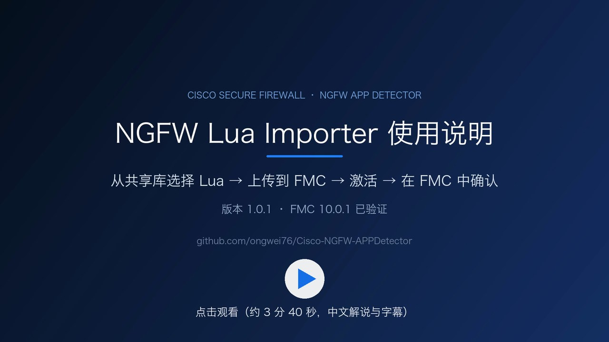

# Cisco NGFW APP Detector

**English** | [简体中文](README.zh-CN.md) — 中文用户请看 [README.zh-CN.md](README.zh-CN.md)

Automatically generate, verify and share OpenAppID custom Lua application detectors for Cisco Secure Firewall (FMC / FTD) — for apps the FMC built-in application library does not yet identify, such as regional apps in mainland China, Hong Kong and other markets.

## Repository layout

| Directory | Contents |
|------|------|
| [`library/`](library/) | Shared Lua library, one folder per app; `index.json` lists SHA256, category and tested FMC version. Every entry was verified on FMC/FTD. |
| [`NGFW_appdetector/`](NGFW_appdetector/) | **NGFW App Detector** (Python, Windows): runs the target app on a Windows endpoint, captures and correlates traffic, generates Lua, imports it into FMC for verification and submits it to the library.<br>`ai_workflow/`: guide and decks for the AI-driven batch workflow. |
| [`NGFW_lua_importer/`](NGFW_lua_importer/) | **NGFW Lua Importer** (Go; single binary for Windows/Linux, universal macOS app): connects to FMC, browses the library and uploads selected detectors, optionally activating them. |
| [`presentation/`](presentation/) | Solution overview decks, AI workflow decks and posters (English / Chinese). |

## Downloads

Prebuilt programs are on [GitHub Releases](https://github.com/ongwei76/Cisco-NGFW-APPDetector/releases):

| Program | Release | Files |
|------|------|------|
| NGFW Lua Importer 1.0.1 | [lua-importer-v1.0.1](https://github.com/ongwei76/Cisco-NGFW-APPDetector/releases/tag/lua-importer-v1.0.1) | Windows x64 `.exe`, macOS universal app `.zip` (Apple silicon + Intel), Linux x64, `SHA256SUMS.txt` |
| NGFW App Detector 1.2.0 | [app-detector-v1.2.0](https://github.com/ongwei76/Cisco-NGFW-APPDetector/releases/tag/app-detector-v1.2.0) | Windows portable ZIP + `.sha256.txt` |

## Which tool do I need?

- **Just use verified detectors:** download NGFW Lua Importer and upload library entries to FMC — no capture or Lua writing needed. See [NGFW_lua_importer/README.md](NGFW_lua_importer/README.md).
- **Build detectors for new apps:** use NGFW App Detector. See [NGFW_appdetector/README.md](NGFW_appdetector/README.md).
- **Let an AI assistant cover a whole batch of apps (e.g. a market's top 50):** follow the [AI-driven workflow](#ai-driven-workflow) below — the AI runs the apps, generates Lua, verifies on FMC and publishes.

## AI-driven workflow

**Idea:** the AI assistant is the operator, NGFW App Detector is the translator, FMC/FTD is the referee. The AI runs apps in bulk on a test VM / Android emulator, captures traffic, builds the Lua from app-owned SNI/Host domains only (no CDNs, ad SDKs or parent-company domains), imports and activates it on FMC, then **runs the app again** — it passes only when FMC connection events show `Web App = <Lua name>`. People only decide the app list, the scope and publishing.

```
Pick list → Check FMC built-ins → Run & capture → App-owned domains → Generate Lua
→ Import & activate → Re-run & verify → Evidence → Evidence deck → Publish to library
```

Verified across 7 rounds (broker PC clients, video apps, China Android top 20/50/100, Android games top 30, Hong Kong market top 50): about 76 new Lua detectors hit live on FTD, all published in [`library/`](library/).

| | Guide | Overview deck (18 slides) |
|---|---|---|
| English | [AI_WORKFLOW.md](NGFW_appdetector/ai_workflow/AI_WORKFLOW.md) | [View PDF](presentation/AI_NGFW_AppDetector_Workflow_EN.pdf) · [Download PPTX](https://github.com/ongwei76/Cisco-NGFW-APPDetector/raw/main/presentation/AI_NGFW_AppDetector_Workflow_EN.pptx) |
| 中文 | [AI_WORKFLOW.zh-CN.md](NGFW_appdetector/ai_workflow/AI_WORKFLOW.zh-CN.md) | [PDF 在线查看](presentation/AI_NGFW_AppDetector_Workflow_中文.pdf) · [PPTX 下载](https://github.com/ongwei76/Cisco-NGFW-APPDetector/raw/main/presentation/AI_NGFW_AppDetector_Workflow_中文.pptx) |

Hand the guide to any AI assistant (Copilot, Claude Code, Codex, Cursor, …) and it can follow it step by step; rules for the AI are in [AGENTS.md](NGFW_appdetector/ai_workflow/AGENTS.md).

## Video tutorials

### NGFW App Detector: building a detector

Walkthrough with China Merchants Securities: capture traffic, correlate with FMC events, generate the Lua, import it into FMC and verify (6:47). Click a cover to play online (720p) or download the 1080p original.

| English subtitles | 中文字幕 |
|---|---|
| [](https://cdn.jsdelivr.net/gh/ongwei76/Cisco-NGFW-APPDetector@main/NGFW_appdetector/docs/videos/NGFW_App_Detector_Tutorial_EN.mp4) | [](https://cdn.jsdelivr.net/gh/ongwei76/Cisco-NGFW-APPDetector@main/NGFW_appdetector/docs/videos/NGFW_App_Detector_Tutorial_ZH.mp4) |
| [Download 1080p](https://github.com/ongwei76/Cisco-NGFW-APPDetector/releases/download/app-detector-v1.2.0/NGFW_App_Detector_Tutorial_EN_1080p.mp4) · [SRT](NGFW_appdetector/docs/videos/NGFW_App_Detector_Tutorial_EN.srt) | [下载 1080p](https://github.com/ongwei76/Cisco-NGFW-APPDetector/releases/download/app-detector-v1.2.0/NGFW_App_Detector_Tutorial_ZH_1080p.mp4) · [SRT](NGFW_appdetector/docs/videos/NGFW_App_Detector_Tutorial_ZH.srt) |

### NGFW Lua Importer: importing library Lua

Full walkthrough of importing Lua with NGFW Lua Importer (connect to FMC → pick Lua → upload and activate → run log → verify the Local App Detector in FMC).

| English (narration + subtitles) | 中文（解说 + 字幕） |
|---|---|
| [](https://cdn.jsdelivr.net/gh/ongwei76/Cisco-NGFW-APPDetector@main/NGFW_lua_importer/docs/videos/NGFW_Lua_Importer_Tutorial_EN.mp4) | [](https://cdn.jsdelivr.net/gh/ongwei76/Cisco-NGFW-APPDetector@main/NGFW_lua_importer/docs/videos/NGFW_Lua_Importer_Tutorial_ZH.mp4) |

## Overview decks

Each deck has 89 slides: 20 overview slides plus a Backup section (slides 21–89) with per-app verification evidence (client screenshot, FMC connection events with IP columns removed, the detector in FMC, matching rules). Chinese and English pages are aligned.

| | View online (PDF) | Download (PPTX) |
|---|---|---|
| English | [NGFW_App_Detector_Solution_Overview_EN.pdf](presentation/NGFW_App_Detector_Solution_Overview_EN.pdf) | [NGFW_App_Detector_Solution_Overview_EN.pptx](https://github.com/ongwei76/Cisco-NGFW-APPDetector/raw/main/presentation/NGFW_App_Detector_Solution_Overview_EN.pptx) |
| 中文 | [NGFW_App_Detector_解决方案介绍_中文.pdf](presentation/NGFW_App_Detector_解决方案介绍_中文.pdf) | [NGFW_App_Detector_解决方案介绍_中文.pptx](https://github.com/ongwei76/Cisco-NGFW-APPDetector/raw/main/presentation/NGFW_App_Detector_解决方案介绍_中文.pptx) |

> GitHub cannot preview PPTX files in the browser. Use the download links above or the [Releases](https://github.com/ongwei76/Cisco-NGFW-APPDetector/releases/tag/slides-2026-11) page.

## Poster

One-page A3 portrait poster (English / Chinese) that scales to A2 / A1 / A0. Scan its QR code with a phone camera (or WeChat Scan) to open this project.

| English | 中文 |
|---|---|
| [NGFW_App_Detector_Poster_EN.pptx](https://github.com/ongwei76/Cisco-NGFW-APPDetector/raw/main/presentation/NGFW_App_Detector_Poster_EN.pptx) | [NGFW_App_Detector_Poster_中文.pptx](https://github.com/ongwei76/Cisco-NGFW-APPDetector/raw/main/presentation/NGFW_App_Detector_Poster_中文.pptx) |

## Compatibility

Tested on FMC 10.0.1 / FTD 10.0.0 (Snort 3). For problems on other versions, email **[yongwli@cisco.com](mailto:yongwli@cisco.com)**.

## Documentation languages

User-facing docs are in English (`README.md`, `*.md`) with a Chinese copy next to each one (`README.zh-CN.md`, `*.zh-CN.md`); every file links to its counterpart in the first lines. Developer docs (ADRs, `AGENTS.md`, `CHANGELOG.md`) are English only.
